# PHASE0_SOTA_SURVEY_REPORT｜2025–2026 年与 SiamDT 红外单目标跟踪优化相关的方法普查与实验池筛选报告

> [!IMPORTANT]
> **会话角色与权限边界声明（Role & Authority Boundary）**
> - **当前会话角色**：SOTA 方法调研与复现可行性执行会话（Phase 0 Execution Session）。
> - **决策权归属**：独立“总控会话（Master Control Session）”拥有科研主线、阶段准入（Phase Gate）与最终技术路线决策权。
> - **硬约束执行核验（`【事实】`）**：本执行会话仅执行 **Phase 0（方法普查与实验池筛选）**；未运行任何大规模训练或评测实验、未修改 `SiamDT` 源码、未设计新模块、未基于单篇论文提出最终创新方案，完成本报告后立即停止并等待总控会话审查。

---

## 一、 证据分级标签规范（Epistemic Tagging Standard）

为保障跨会话科研证据链的严谨性，本报告所有关键陈述均严格标注以下四类认识论标签（Epistemic Tags）：

- **`【事实】`（Verified Fact）**：由本执行会话通过本地文件系统核查、代码静态审计、终端硬件探针（`nvidia-smi`）、Git 远端仓库探针（`git ls-remote`）或官方仓库 `README.md` / `MODEL_ZOO.md` 原文核验确认的客观事实。
- **`【文献结论】`（Literature Conclusion）**：候选方法原论文或官方技术报告中声明的实验结论、架构主张及公开基准汇报指标（未在本项目本地统一环境中重跑验证前，不作为本项目实测事实）。
- **`【执行会话推测】`（Execution Session Inference）**：基于 `SiamDT` 源码实现细节、候选方法核心机制与本地硬件环境（RTX 5080 Blackwell 架构）所作出的机制互补性分析、跨模态迁移潜力判断及复现摩擦预估。
- **`【建议】`（Recommendation）**：供总控会话（Master Control Session）在 Phase 1 及后续阶段决策时参考的实验池准入建议、评测协议对齐方案及风险规避措施。

---

## 二、 本地 SiamDT 基线源码解构与软硬件/评测环境事实审计

在筛选 2025–2026 年 SOTA（State-of-the-Art，当前最优水平）方法前，本会话对本地已有代码库、硬件环境及数据集进行了只读审计，确立如下基准事实：

### 2.1 本地硬件与软件栈约束（`【事实】`）

1. **GPU 硬件（`【事实】`）**：
   - 本地计算节点配备 **NVIDIA GeForce RTX 5080（16,303 MiB 显存，驱动版本 591.86，Blackwell 架构，计算能力 `sm_120`）**。
   - **架构兼容性约束（`【事实】`）**：Blackwell `sm_120` 架构需要 **PyTorch $\ge 2.6$/$2.7$ + CUDA 12.8（`cu128`）** 才能原生支持 GPU 算子执行。早期基于 PyTorch 1.7–1.11 的预编译二进制包（如旧版 `mmcv-full==1.3.0` / `1.4.7`）不包含 `sm_120` PTX/SASS 内核，直接运行会触发 `CUDA error: no kernel image is available for execution on the device`，必须基于源码重新编译自定义算子或迁移至纯 PyTorch 2.x 算子环境。
2. **本地数据集资产（`【事实】`）**：
   - 路径 `E:/PHD/YB/dataset/` 下已存有 `Anti-UAV`、`Anti-UAV410-tiny` 与 `Anti-MUAV15` 数据集目录。
3. **本地评测工程与 SiamDT 源码位置（`【事实】`）**：
   - 评测主工程位于 [Anti_yb](file:///E:/PHD/YB/Anti_yb/README.md)，包含统一评测入口 [Evaluation_for_ALL.py](file:///E:/PHD/YB/Anti_yb/Evaluation_for_ALL.py)、跟踪器注册表 [trackers.py](file:///E:/PHD/YB/Anti_yb/utils/trackers.py) 以及 Anti-UAV410 官方评测协议脚本 [anti_uav.py](file:///E:/PHD/YB/Anti_yb/experiments/anti_uav.py)。
   - `SiamDT` 官方源码位于 [trackers/SiamDT](file:///E:/PHD/YB/Anti_yb/trackers/SiamDT/README.md)。

### 2.2 SiamDT 基线架构与核心机制代码级解构（`【事实】`）

通过审计配置文件 [siamdt_swin_tiny_sgd.py](file:///E:/PHD/YB/Anti_yb/trackers/SiamDT/configs/siamdt_swin_tiny_sgd.py)、检测器主体 [siamdt_rcnn.py](file:///E:/PHD/YB/Anti_yb/trackers/SiamDT/trackers/siamdt_rcnn.py)、推理控制器 [siamdt_tracking.py](file:///E:/PHD/YB/Anti_yb/trackers/SiamDT/trackers/siamdt_tracking.py) 与相似度编码器 [similarity_encoders.py](file:///E:/PHD/YB/Anti_yb/trackers/SiamDT/trackers/similarity_encoders.py)，确认 `SiamDT` 的真实工程实现如下：

```mermaid
flowchart LR
    subgraph Input["1. 全图输入 (Full-Frame)"]
        Z["首帧/动态模板帧 z<br/>Resize: (480..800)×1333"]
        X["当前搜索帧 x (全图)<br/>Resize: (480..800)×1333"]
    end

    subgraph BackboneNeck["2. 骨干与特征金字塔"]
        Swin["Swin-Tiny Backbone<br/>dims=[96,192,384,768]"]
        FPN["5层 FPN Neck<br/>out_channels=256, num_outs=5"]
    end

    subgraph DualRPN["3. Dual-Semantic RPN"]
        RoIZ["7×7 SingleRoIExtractor<br/>提取模板特征 z_roi"]
        RPNSim["RPN_Similarity_Learning<br/>7×7 互相关生成 x_corr"]
        RPNAdd["特征融合: x + x_corr<br/>RPNHead 生成最多1000候选框"]
    end

    subgraph VersatileRCNN["4. Versatile RCNN & BCS"]
        RoIX["候选框 7×7 RoIAlign<br/>提取 bbox_feats_x"]
        MatchBranch["实例匹配分支 (tra_bboxes)<br/>RCNN_Similarity_Learning"]
        DetBranch["类别检测分支 (det_bboxes)<br/>直接输入 Shared2FCBBoxHead"]
        Top5["合并两路候选并取 Top-5<br/>(ens_bboxes)"]
        BCS["背景杂波抑制 (BCS)<br/>减去11个背景RoI (_bbox_feats_bg)<br/>最大匹配分 + 重叠框置信度增强"]
        Update["动态模板更新 (_update_query)<br/>双分支得分和>1.9 且 IoU>0.8<br/>EMA: 0.99*z_old + 0.01*z_new"]
    end

    Z --> Swin
    X --> Swin
    Swin --> FPN
    FPN --> RoIZ
    FPN --> RPNSim
    RoIZ --> RPNSim
    RPNSim --> RPNAdd
    RPNAdd --> RoIX
    RoIX --> MatchBranch
    RoIX --> DetBranch
    MatchBranch --> Top5
    DetBranch --> Top5
    Top5 --> BCS
    BCS --> Update
```

- **全图全局搜索范式（Full-Frame Global Search）（`【事实】`）**：不同于主流单流 ViT 跟踪器（如 OSTrack、LoRAT、SUTrack）在上一帧预测框周围裁剪 $4\times$ 或 $5\times$ 局部搜索区域（Local Search Crop，如 $224\times 224$ 或 $384\times 384$），[`SiamDT`](file:///E:/PHD/YB/Anti_yb/trackers/SiamDT/configs/siamdt_swin_tiny_sgd.py#L94-L116) 直接将整幅红外视频帧（缩放至长边 $\le 1333$，短边 $480\sim 800$）送入 `Swin-Tiny + 5层 FPN`。这使得 `SiamDT` 天然具备**全图重检测（Global Re-detection）**能力，但整图特征计算开销较大且受大面积背景杂波干扰。
- **双语义区域提议网络（Dual-Semantic RPN）（`【事实】`）**：在 [`RPN_Similarity_Learning`](file:///E:/PHD/YB/Anti_yb/trackers/SiamDT/trackers/similarity_encoders.py#L14-L53) 中，利用 `SingleRoIExtractor` 提取模板 $7\times 7$ 特征并经 $1\times 1$ 卷积变换为相关核，与搜索帧 5 个尺度的 FPN 特征逐层做 $7\times 7$ 互相关（`F.conv2d(..., padding=3)`）得到 `x_corr`，再以残差相加 `x = [a + b for a, b in zip(x, x_corr)]` 送入 `RPNHead` 产生 1000 个候选区域（Proposals）。
- **多能 R-CNN 双分支协同（Versatile RCNN）（`【事实】`）**：在 [`SiamDTRCNN.simple_test_bboxes`](file:///E:/PHD/YB/Anti_yb/trackers/SiamDT/trackers/siamdt_rcnn.py#L143-L195) 中，候选框同时走两条路径并共享 `Shared2FCBBoxHead`：
  1. **实例匹配分支（`tra_bboxes`）**：通过 [`RCNN_Similarity_Learning`](file:///E:/PHD/YB/Anti_yb/trackers/SiamDT/trackers/similarity_encoders.py#L56-L108) 将模板 RoI（`bbox_feats_z`）与候选 RoI（`bbox_feats_x`）各自做 $3\times 3$ 卷积后逐元素相乘（Element-wise Multiplication）再经 $1\times 1$ 卷积聚合。
  2. **类别检测分支（`det_bboxes`）**：直接将 `bbox_feats_x` 输入检测头，识别具有共性热红外无人机外观的目标。
  3. 两路预测拼接为 `ens_bboxes`，按置信度排序取前 5 个候选（`Top_NUM = 5`）。
- **背景杂波抑制（Background Clutter Suppression, BCS）（`【事实】`）**：在 [`SiamDTRCNN._extract_query`](file:///E:/PHD/YB/Anti_yb/trackers/SiamDT/trackers/siamdt_rcnn.py#L81-L119) 中，从初始帧/更新帧与真实目标框（或预测框）$\text{IoU} \le 0$ 的RPN提议中采样最多 **11 个背景 RoI 特征（`_bbox_feats_bg`）**。推理时（[`siamdt_rcnn.py`](file:///E:/PHD/YB/Anti_yb/trackers/SiamDT/trackers/siamdt_rcnn.py#L168-L185)），计算 Top-5 候选与这 11 个背景模板的匹配得分 `mm_scores`，直接从候选框得分中减去最大背景匹配分（`ens_bboxes[:Top_NUM, -1] -= mm_scores`），并对高度重叠（$\text{IoU} > 0.8$）的双分支候选框按重叠度加权提升得分。
- **启发式动态模板更新（Heuristic Dynamic Update）（`【事实】`）**：在 [`SiamDTRCNN._update_query`](file:///E:/PHD/YB/Anti_yb/trackers/SiamDT/trackers/siamdt_rcnn.py#L121-L141) 中，仅当 `tra_bboxes[0, -1] + det_bboxes[0, -1] > 1.9` 且两分支首选框 $\text{IoU} > 0.8$ 时触发更新：目标模板采取固定系数指数移动平均 `_bbox_feats_z = 0.99 * _bbox_feats_z + 0.01 * bbox_feats_z`，而背景模板 `_bbox_feats_bg` 则直接替换为当前帧新采样的 11 个背景 RoI。

### 2.3 Anti-UAV410 公平评测协议与潜在陷阱核查（`【事实】`）

审计 [`experiments/anti_uav.py`](file:///E:/PHD/YB/Anti_yb/experiments/anti_uav.py#L221-L246) 与 [`utils/trackers.py`](file:///E:/PHD/YB/Anti_yb/utils/trackers.py#L1-L72) 发现两个对后续公平对比至关重要的协议事实：

1. **双轨评测协议区分（Default vs. Re-trained）（`【事实】`）**：
   - [`utils/trackers.py`](file:///E:/PHD/YB/Anti_yb/utils/trackers.py#L5-L71) 严格区分 **Default Trackers（零样本跨域评测）**（仅使用通用 RGB 数据集如 LaSOT、GOT-10k、TrackingNet、COCO 训练的官方权重直接测试）与 **Re-trained Trackers（域内重训练评测）**（使用 `Anti-UAV410` 训练集 `uavtir_train` 重新训练或微调后的权重测试，如 `SiamDT` 在论文中汇报的 68.19% SA 即属于域内训练结果）。
2. **State Accuracy (`SA`) 指标中的“目标消失（Out-of-View）”判分机制（`【事实】`）**：
   - 在 [`ExperimentAntiUAV410.eval()`](file:///E:/PHD/YB/Anti_yb/experiments/anti_uav.py#L221-L236) 中，每一帧的状态精度公式为：
     $$\text{SA}_t = \text{IoU}(\text{pred}_t, \text{gt}_t) \times \mathbb{I}(\text{exist}_t == 1) + \text{not\_exist}(\text{pred}_t) \times (1 - \mathbb{I}(\text{exist}_t == 1))$$
   - 其中 [`not_exist(pred)`](file:///E:/PHD/YB/Anti_yb/experiments/anti_uav.py#L207-L208) 定义为 `return (len(pred) == 1 and pred[0] == 0) or len(pred) == 0`。这意味着当红外无人机飞出视野或被完全遮挡（`exist == 0`）时，只有输出空框或 `[0]` 的跟踪器能得 `1.0` 分；而**默认每帧必定输出 4 元组边界框 `[x, y, w, h]` 的主流跟踪器在所有 `exist == 0` 帧上得分均为 `0.0`**（但事实上，包括 `SiamDT` 在内的绝大部分已有基线在 [`siamdt_tracking.py`](file:///E:/PHD/YB/Anti_yb/trackers/SiamDT/trackers/siamdt_tracking.py#L55-L60) 中同样每帧固定输出 4 元组框 `[x1, y1, w, h]`）。在统一公平评测时，必须锁定一致的框输出格式，严禁部分方法使用隐式空框阈值而另一部分方法固定输出 4 元组框。

---

## 三、 Core Experimental Pool（核心实验池：14 个候选方法）

> [!TIP]
> **Core Experimental Pool（核心实验池）准入标准（`【事实】`）**
> 1. **源码已开源且经核验非空**：通过 `git ls-remote` 及源码文件级拉取核验，包含完整训练/推理实现。
> 2. **预训练/训练后模型权重已公开**：官方 `README.md` 或 `MODEL_ZOO.md` 提供可访问的 HuggingFace、Google Drive 或百度网盘（含提取码）权重链接。
> 3. **具备本地统一环境（RTX 5080 + Anti-UAV410）公平运行条件**：主要基于标准 PyTorch 2.x / `timm` / `transformers` 架构，无需依赖已废弃的旧版 CUDA 10/11 闭源二进制算子，可在统一协议下直接开展 Zero-Shot（零样本跨域）或 In-Domain（域内微调）公平对比。

### 3.1 Core Experimental Pool 总览对比表

| 编号 | 方法名称 | 年份与发表会议/期刊 | 技术路线 | 核心互补机制（相对 SiamDT） | 源码状态 (`【事实】`) | 权重状态 (`【事实】`) | RTX 5080 / Anti-UAV 适配难度 | 预计复现风险 |
| :--- | :--- | :--- | :--- | :--- | :--- | :--- | :--- | :--- |
| **C-01** | **SUTrack** | AAAI 2025 | 多模态统一单流 ViT (`Fast-iTPN`) | RGB/TIR/RGB-T 多模态统一输入接口 + 类别文本/软令牌联合建模 | 完整开源 | HuggingFace & 百度网盘全系公开 (`T224`~`L384`) | **低**（纯 PyTorch，原生支持 TIR） | **低** |
| **C-02** | **SPMTrack** | CVPR 2025 | 视觉大模型 PEFT + 时空专家混合 (`DINOv2 + TMoE`) | 跟踪混合专家（TMoE）路由 + 多参考帧时空上下文参数高效微调 | 完整开源 | Google Drive 公开 (`SPMTrack-B` 权重与日志) | **低**（基于 `LoRAT` 纯 PyTorch 2.3+ 框架） | **低** |
| **C-03** | **UETrack** | CVPR 2026 | 统一高效单流 MoE + 自适应蒸馏 | 相似度驱动软分配令牌池化专家（TP-MoE）+ 目标感知自适应蒸馏（TAD） | 完整开源 | HuggingFace 全系公开 (`UETrack-B/S/T`) | **低**（纯 PyTorch，推理达 163–221 FPS） | **低** |
| **C-04** | **UTPTrack** | CVPR 2026 | 多模板统一令牌剪枝单流跟踪 (`OSTrack/SUTrack` 基座) | 静态模板 + 动态模板 + 搜索区统一令牌剪枝（削减 >65% 冗余背景令牌） | 完整开源 | HuggingFace 全系公开 (`UTPTrack-O/S`) | **低**（纯 PyTorch，直接兼容 `SUTrack`） | **低** |
| **C-05** | **ORTrack** | CVPR 2025 | 无人机遮挡鲁棒实时 ViT | 特征掩码提示（Feature Mask Prompting）遮挡模拟 + 无遮挡教师蒸馏 | 完整开源 | Google Drive & 百度网盘公开 (`pwd=cvpr`) | **低**（标准 `timm` DeiT/ViT，无自定义算子） | **低** |
| **C-06** | **SGLATrack** | CVPR 2025 | 无人机相似度引导层自适应 ViT | 模板-搜索余弦相似度矩阵引导动态 Transformer 层剪枝 | 完整开源 | Google Drive 公开 (`DeiT/ViT/EVA` 三版本) | **低**（标准 PyTorch ViT 架构） | **低** |
| **C-07** | **LETrack** | CVPR 2026 | 无人机低成本时序特征传播 ViT | 轻量级跨帧时序令牌交互（无需维护高开销多帧记忆库） | 完整开源 | Google Drive & 百度网盘公开 (`pwd=6n35`) | **低**（与 `SGLATrack` 同实验室标准框架） | **低** |
| **C-08** | **AsymTrack** | AAAI 2025 | 非对称双流孪生调制 + 目标感知增强 | 非对称模板调制（Asymmetric Template Modulation）+ 目标感知增强模块 | 完整开源 | Google Drive & 百度网盘公开 (`pwd=asym`) | **低**（纯 PyTorch 架构，极高吞吐） | **低** |
| **C-09** | **MPT** | ICML 2025 | 即插即用长程运动提示跟踪 (`Motion-Prompt`) | 历史长轨迹编码器（Motion Prompt Encoder）+ 自适应视觉-运动融合 | 完整开源 | 百度网盘公开 (`pwd=8j2g`) | **低~中**（纯 PyTorch，需对齐历史框缓冲队列） | **低** |
| **C-10** | **DAM4SAM** | CVPR 2025 / IJCV 2026 | 免训练分心物感知记忆 (`SAM 2.1` 基座) | 近期外观记忆（RAM）与分心物感知记忆（DAM）解耦及内省更新 | 完整开源 | 官方脚本自动下载 `SAM 2.1` 公开权重 | **低**（PyTorch $\ge 2.1$，自带 `run_on_box_dataset.py`） | **低** |
| **C-11** | **SAMURAI** | IEEE TIP 2026 | 免训练运动感知记忆 (`SAM 2.1` + 卡尔曼门控) | 卡尔曼滤波运动亲和度评分 + 混合记忆择优门控（防遮挡误更新） | 完整开源 | 官方脚本自动下载 `SAM 2.1` 公开权重 | **低**（支持首帧 BBox 初始化推理） | **低** |
| **C-12** | **ReFocus-TIR** | IEEE TNNLS 2024/2025 | 热红外专用参数高效注意力重聚焦 | 注意力重聚焦适配器（抑制热红外无纹理目标导致的注意力弥散） | 完整开源 | Google Drive & 百度网盘公开 (`pwd=v27s`) | **低**（纯 PyTorch ViT + Adapter） | **低** |
| **C-13** | **LoRAT** | ECCV 2024 (2025.12更新) | 视觉大模型 LoRA 基座 (`DINOv2 + LoRA`) | 单流位置编码解耦 + 零推理开销 LoRA 微调（`SPMTrack`/`DTPTrack` 基础底座） | 完整开源 | Google Drive 全系公开 (`B/L/g-224/378`) | **极低**（原生支持 Windows + PyTorch 2.x + `safetensors`） | **极低** |
| **C-14** | **MCITrack** | AAAI 2025 | 视频级多上下文 Mamba 隐状态跟踪 | 利用 Mamba SSM 隐藏状态在视频级传递长程连续历史上下文 | 完整开源 | Google Drive 全系公开 (`B224`~`L384`) | **中**（需在 RTX 5080 编译 `mamba-ssm`/`causal-conv1d`） | **中** |

---

### 3.2 Core Experimental Pool 逐方法详细档案（15 项必填字段全量记录）

#### 【C-01】SUTrack（AAAI 2025）
- **论文名称**：*SUTrack: Towards Simple and Unified Single Object Tracking*
- **年份**：2025（AAAI 2025）
- **任务类型**：多模态统一单目标跟踪（涵盖 RGB、TIR 热红外、RGB-T、RGB-D、RGB-E 五类任务）
- **技术路线**：基于 `Fast-iTPN` 层次化视觉 Transformer 的单流统一多模态跟踪框架（One-Stream Unified Multi-Modal Transformer）
- **核心机制**：
  - `【文献结论】` 将 RGB、热红外（TIR）、深度等不同模态输入统一映射至共享的图文/多模态 Token 空间，通过模态自适应令牌（Modality-Adaptive Tokens）与动态双模板（初始模板 + 在线动态模板）实现单套模型架构与单套参数跨模态通用跟踪。
- **与 SiamDT 的主要区别**：
  - `【事实】` `SiamDT` 采用“全图输入 + Swin-Tiny + FPN + 两阶段 RPN/RCNN 显式互相关”架构；`SUTrack` 采用“局部搜索区裁剪（$224^2$ 或 $384^2$）+ Fast-iTPN 单流早期注意力融合 + 无锚点 CenterHead 预测”架构，且 `SUTrack` 在预训练阶段即原生纳入了红外（TIR/RGB-T）数据分布。
- **论文/项目地址**：`https://github.com/chenxin-dlut/SUTrack`
- **源码状态**：`【事实】` 已完整开源（含训练、多模态数据加载及评测代码，本地已核验 `README.md`）。
- **权重状态**：`【事实】` 已完整公开，托管于 HuggingFace（`https://huggingface.co/xche32/SUTrack`）及百度网盘（提取码 `jqpb`），包含 `SUTrack-T224`、`SUTrack-B224`、`SUTrack-B384`、`SUTrack-L224`、`SUTrack-L384` 全尺寸权重。
- **数据集**：`【文献结论】` LaSOT、GOT-10k、TrackingNet、UAV123、LasHeR（RGB-T）、PTB-TIR、LSOTB-TIR 等。
- **评价协议**：`【文献结论】` 标准 OPE（AUC / Precision / Normalized Precision）。
- **Anti-UAV 适配难度**：**低**。`【事实】` 纯 PyTorch 实现，无特殊闭源 C++ 算子，且模型本身支持单通道/三通道伪彩 TIR 图像输入。
- **预计复现风险**：**低**。`【执行会话推测】` 唯一需要注意的是在小目标剧烈跳变或完全出视野重入时，局部裁剪范式（$224^2/384^2$）相比 `SiamDT` 全图扫描可能更容易丢失快速机动无人机，这正可作为“局部单流 ViT vs. 全图两阶段检测跟踪”的核心对比基准。
- **推荐进入 Core 还是 Reference**：**Core Experimental Pool**。
- **推荐理由**：`【建议】` 2025 年多模态/红外单目标跟踪领域最具代表性的统一基座，同时也是 CVPR 2026 `UTPTrack-S` 的直接底层架构，具备极高的零样本与微调对比价值。

---

#### 【C-02】SPMTrack（CVPR 2025）
- **论文名称**：*SPMTrack: Spatio-Temporal Parameter-Efficient Fine-Tuning with Mixture of Experts for Scalable Visual Tracking*
- **年份**：2025（CVPR 2025）
- **任务类型**：通用单目标跟踪（基于视觉基础模型的参数高效微调与时空建模）
- **技术路线**：冻结视觉基础模型（`DINOv2` ViT）+ 跟踪混合专家（Tracking Mixture-of-Experts, TMoE）+ 多参考帧时空上下文建模
- **核心机制**：
  - `【文献结论】` 针对直接全量微调大模型易过拟合且忽略长程时空线索的问题，设计了轻量级可插拔的 TMoE 模块作为 PEFT（Parameter-Efficient Fine-Tuning，参数高效微调）适配器，通过路由器（Router）将多参考帧时空特征自适应分配给多个专家分支，以极少的可训练参数捕获复杂外观演化。
- **与 SiamDT 的主要区别**：
  - `【事实】` `SiamDT` 使用 ImageNet-1K 预训练的 `Swin-Tiny` 并采用全参数 SGD 微调，仅靠启发式阈值（$>1.9$ 且 $\text{IoU}>0.8$）做单模板特征 EMA（$0.99/0.01$）更新；`SPMTrack` 冻结自监督预训练的 `DINOv2` 主干，通过可学习的 MoE 专家路由融合多个历史参考帧。
- **论文/项目地址**：`https://github.com/WenRuiCai/SPMTrack`
- **源码状态**：`【事实】` 已完整开源（基于 `LoRAT/trackit` 现代化框架构建，原生支持 PyTorch 2.3.1 + CUDA 12）。
- **权重状态**：`【事实】` 已公开，Google Drive（`https://drive.google.com/drive/folders/1bPnVG7ZcTNHgRgVf7Jydp9zFwdQf-3bV`）提供 `SPMTrack-B` 完整预训练权重与评测结果。
- **数据集**：`【文献结论】` LaSOT、LaSOT_ext、TrackingNet、GOT-10k、TNL2K。
- **评价协议**：`【文献结论】` 标准 OPE（AUC / P / $P_{\text{norm}}$）。
- **Anti-UAV 适配难度**：**低**。`【事实】` 代码库直接继承 `LoRAT` 的纯 PyTorch 2.x 架构，在 RTX 5080 上无需编译任何遗留 CUDA 扩展即可运行。
- **预计复现风险**：**低**。
- **推荐进入 Core 还是 Reference**：**Core Experimental Pool**。
- **推荐理由**：`【建议】` 代表了 2025 年“DINOv2 视觉基础模型 + MoE 时空 PEFT 微调”的主流强基线；其多参考帧 MoE 路由思想与 `SiamDT` 脆弱的固定系数模板更新形成鲜明机制对照。

---

#### 【C-03】UETrack（CVPR 2026）
- **论文名称**：*UETrack: A Unified and Efficient Framework for Single Object Tracking*
- **年份**：2026（CVPR 2026）
- **任务类型**：高速统一单目标跟踪
- **技术路线**：基于令牌池化混合专家（Token-Pooling MoE）与目标感知自适应蒸馏（Target-aware Adaptive Distillation）的单流高效架构
- **核心机制**：
  - `【文献结论】` 提出两大核心模块：（1）**TP-MoE（Token-Pooling-based Mixture-of-Experts）**：利用模板与搜索区之间的相似度引导软分配（Similarity-driven Soft Assignment），将冗余令牌池化压缩后再送入专家网络，在不增加计算开销的前提下扩展模型容量；（2）**TAD（Target-aware Adaptive Distillation）**：在特征蒸馏时对前景目标区域与复杂背景区域施加自适应权重，使轻量级学生模型精准继承教师模型的目标判别力。
- **与 SiamDT 的主要区别**：
  - `【事实】` `SiamDT` 通过显式采样 11 个背景 RoI（`_bbox_feats_bg`）并在 R-CNN 阶段做匹配分相减来抑制杂波；`UETrack` 则在特征编码阶段通过模板-搜索相似度引导的 Token-Pooling MoE 软路由抑制背景噪声，并通过目标感知蒸馏强化小/弱目标响应，推理速度高达 163–221 FPS（远高于 `SiamDT` 的两阶段全图推理速度）。
- **论文/项目地址**：`https://github.com/kangben258/UETrack`
- **源码状态**：`【事实】` 已完整开源（含训练、蒸馏与评测全流程代码）。
- **权重状态**：`【事实】` 已完整公开，托管于 HuggingFace（`https://huggingface.co/kangben258/UETrack`），包含 `UETrack-B`、`UETrack-S`、`UETrack-T` 模型权重及教师模型权重。
- **数据集**：`【文献结论】` LaSOT、LaSOT_ext、GOT-10k、TrackingNet、UAV123、NFS、OTB100。
- **评价协议**：`【文献结论】` 标准 OPE 协议。
- **Anti-UAV 适配难度**：**低**。`【事实】` 纯 PyTorch 实现，HuggingFace 权重拉取极其便捷。
- **预计复现风险**：**低**。
- **推荐进入 Core 还是 Reference**：**Core Experimental Pool**。
- **推荐理由**：`【建议】` CVPR 2026 最新已开源且带完整权重的 SOTA 跟踪器，其“相似度驱动软路由 TP-MoE”和“目标感知蒸馏 TAD”均可为改进 `SiamDT` 的 RPN/FPN 相似度建模提供高价值对照。

---

#### 【C-04】UTPTrack（CVPR 2026）
- **论文名称**：*UTPTrack: Towards Simple and Unified Token Pruning for Visual Tracking*
- **年份**：2026（CVPR 2026）
- **任务类型**：高效单目标与多模态跟踪（统一令牌剪枝）
- **技术路线**：面向静态模板、动态模板与搜索区域的统一动态令牌剪枝（Unified Token Pruning）框架，直接构建于 `OSTrack`（`UTPTrack-O`）与 `SUTrack`（`UTPTrack-S`）之上
- **核心机制**：
  - `【文献结论】` 发现现有跟踪器在引入多帧动态模板后存在严重的时空令牌冗余，且模板内部背景像素会污染互注意力；提出统一令牌剪枝机制，同时剔除搜索区域背景令牌以及静态/动态模板中的非目标背景令牌，在削减超过 65% 令牌计算量的同时反而提升了跟踪精度。
- **与 SiamDT 的主要区别**：
  - `【事实】` `SiamDT` 的 `SingleRoIExtractor` 从模板框内均匀提取 $7\times 7$ 网格特征，当红外无人机形状不规则或存在框内背景时，模板核本身混有背景噪声；`UTPTrack` 则从细粒度 Token 层面同时净化模板与搜索区域特征。
- **论文/项目地址**：`https://github.com/EIT-NLP/UTPTrack`
- **源码状态**：`【事实】` 已完整开源（含 `UTPTrack-O` 与 `UTPTrack-S` 两套完整实现）。
- **权重状态**：`【事实】` 已完整公开，托管于 HuggingFace（`https://huggingface.co/HarrisonWu/UTPTrack`）。
- **数据集**：`【文献结论】` LaSOT、GOT-10k、TrackingNet、LasHeR（RGB-T）、VisEvent 等。
- **评价协议**：`【文献结论】` 标准 OPE 协议。
- **Anti-UAV 适配难度**：**低**。`【事实】` 纯 PyTorch 架构，与 `C-01 SUTrack` 环境完全兼容。
- **预计复现风险**：**低**。
- **推荐进入 Core 还是 Reference**：**Core Experimental Pool**。
- **推荐理由**：`【建议】` CVPR 2026 唯一同时提供 RGB 基座（`UTPTrack-O`）与多模态/红外基座（`UTPTrack-S`）开源权重的令牌净化方法，可直接与 `SUTrack` 构成受控消融对（检验背景令牌剔除在红外无人机杂波场景下的真实收益）。

---

#### 【C-05】ORTrack（CVPR 2025）
- **论文名称**：*Learning Occlusion-Robust Vision Transformers for Real-Time UAV Tracking*
- **年份**：2025（CVPR 2025）
- **任务类型**：无人机（UAV）实时抗遮挡单目标跟踪
- **技术路线**：特征掩码提示（Feature Mask Prompting）遮挡模拟 + 教师-学生跨视图知识蒸馏（轻量级 ViT/DeiT）
- **核心机制**：
  - `【文献结论】` 针对无人机跟踪中频繁出现的树木/建筑局部遮挡与目标残缺问题，在训练阶段通过特征级掩码提示（Feature Mask Prompting）模拟多样化的复杂遮挡模式，并利用接收完整无遮挡特征的教师网络（Teacher）指导受遮挡学生网络（Student）重建抗遮挡表征，在推理阶段无需任何额外开销即可实现高鲁棒实时无人机跟踪。
- **与 SiamDT 的主要区别**：
  - `【事实】` `SiamDT` 未针对遮挡（Occlusion, `OC` 属性）进行专门的特征级表征鲁棒化训练，仅依赖 R-CNN 类别检测分支在遮挡恢复后重新捕获目标；`ORTrack` 则在骨干特征提取层直接注入抗遮挡不变性。
- **论文/项目地址**：`https://github.com/wuyou3474/ORTrack`
- **源码状态**：`【事实】` 已完整开源（含训练与评测代码）。
- **权重状态**：`【事实】` 已完整公开，托管于 Google Drive 及百度网盘（提取码 `cvpr`）。
- **数据集**：`【文献结论】` UAV123、UAV123@10fps、DTB70、UAVDT、VisDrone2018。
- **评价协议**：`【文献结论】` UAV 标准 OPE 协议（Success Rate / Precision Rate）。
- **Anti-UAV 适配难度**：**低**。`【事实】` 基于标准 `timm`（`deit_tiny_patch16_224` 等）与原生 PyTorch 实现，无自定义 CUDA 算子。
- **预计复现风险**：**低**。
- **推荐进入 Core 还是 Reference**：**Core Experimental Pool**。
- **推荐理由**：`【建议】` 专为 UAV 无人机视角与遮挡挑战设计的 CVPR 2025 方法，代码轻量、依赖干净，非常适合在 `Anti-UAV410` 的 `OC`（Occlusion，遮挡）与 `DBC`（Dynamic Background Clutter，动态背景杂波）属性子集上进行专项对比。

---

#### 【C-06】SGLATrack（CVPR 2025）
- **论文名称**：*Similarity-Guided Layer-Adaptive Vision Transformer for UAV Tracking*
- **年份**：2025（CVPR 2025）
- **任务类型**：高效无人机（UAV）单目标跟踪
- **技术路线**：模板-搜索余弦相似度引导的动态层自适应（Layer-Adaptive）Vision Transformer
- **核心机制**：
  - `【文献结论】` 针对 UAV 场景下背景复杂度随时间剧烈变化的特点，利用模板特征与搜索区域特征之间的余弦相似度矩阵（Cosine Similarity Matrix）评估当前帧跟踪难度，通过轻量级相似度引导模块动态决定激活或跳过后续 Transformer 层，减少冗余深层计算并避免简单小目标在过深网络中发生特征平滑退化。
- **与 SiamDT 的主要区别**：
  - `【事实】` `SiamDT` 采用固定深度的 `Swin-Tiny` + 5 层 FPN，仅在颈部之后做静态的 $7\times 7$ RPN/RCNN 互相关；`SGLATrack` 将模板-搜索相似度计算前移至骨干网络各层内部，用于动态调节特征提取深度。
- **论文/项目地址**：`https://github.com/GXNU-ZhongLab/SGLATrack`
- **源码状态**：`【事实】` 已完整开源。
- **权重状态**：`【事实】` 已完整公开，Google Drive（`https://drive.google.com/drive/folders/1sHL7aFVZFwkPy6js48x-EKfoZC7oJc9X`）提供 `SGLATrack-DeiT`、`SGLATrack-ViT`、`SGLATrack-EVA` 三个版本模型权重。
- **数据集**：`【文献结论】` DTB70、UAVDT、VisDrone2018、UAV123、UAV123@10fps。
- **评价协议**：`【文献结论】` UAV 标准 OPE 协议。
- **Anti-UAV 适配难度**：**低**。`【事实】` 纯 PyTorch + `timm` 实现，RTX 5080 直接兼容。
- **预计复现风险**：**低**。
- **推荐进入 Core 还是 Reference**：**Core Experimental Pool**。
- **推荐理由**：`【建议】` `SGLATrack` 的“余弦相似度引导自适应特征深度”机制对于理解热红外弱纹理小目标在深层网络中的特征过度平滑（Over-smoothing）问题具有直接实验参考价值。

---

#### 【C-07】LETrack（CVPR 2026）
- **论文名称**：*Toward Low-Cost yet Effective Temporal Learning for UAV Tracking*
- **年份**：2026（CVPR 2026）
- **任务类型**：无人机（UAV）低开销时序单目标跟踪
- **技术路线**：面向算力受限 UAV 跟踪的轻量级跨帧时序令牌传播架构
- **核心机制**：
  - `【文献结论】` 针对传统视频级跟踪器维护多帧高维模板记忆库导致显存与延迟暴增的问题，设计了极低开销的时序学习模块，仅通过紧凑的时序状态令牌（Temporal Tokens）在相邻帧间传递运动与外观演变上下文，兼顾长时无人机跟踪稳定性与高帧率。
- **与 SiamDT 的主要区别**：
  - `【事实】` `SiamDT` 的帧间联系仅靠 `_bbox_feats_z` 的 $0.99/0.01$ 线性加权及 `_bbox_feats_bg` 的整批替换，缺乏连续帧间的时序演化建模；`LETrack` 通过端到端训练的低成本时序模块传递跨帧线索。
- **论文/项目地址**：`https://github.com/GXNU-ZhongLab/LETrack`
- **源码状态**：`【事实】` 已完整开源（与 `SGLATrack` 同属广西师范大学钟必能教授团队，工程目录规范一致）。
- **权重状态**：`【事实】` 已完整公开，提供百度网盘（提取码 `6n35`）与 Google Drive（`https://drive.google.com/drive/folders/1NzD3LRCr-X80qQlvs9ygcEezh_E3Gr0A`）双渠道模型权重与原始评测结果。
- **数据集**：`【文献结论】` DTB70、UAV123、UAVTrack112、VisDrone 等 UAV 基准。
- **评价协议**：`【文献结论】` UAV 标准 OPE 协议。
- **Anti-UAV 适配难度**：**低**。`【事实】` 与 `SGLATrack` 共享相同的纯 PyTorch 依赖环境。
- **预计复现风险**：**低**。
- **推荐进入 Core 还是 Reference**：**Core Experimental Pool**。
- **推荐理由**：`【建议】` CVPR 2026 无人机跟踪方向少有的“代码+双网盘权重”全齐的时序跟踪方法，可与同团队 CVPR 2025 的单帧方法 `SGLATrack` 进行“单帧 vs. 低成本时序”受控对比。

---

#### 【C-08】AsymTrack（AAAI 2025）
- **论文名称**：*Two-Stream Beats One-Stream: Asymmetric Siamese Network for Efficient Visual Tracking*
- **年份**：2025（AAAI 2025）
- **任务类型**：高效双流孪生单目标跟踪
- **技术路线**：非对称双流孪生网络（Asymmetric Two-Stream Siamese Network）+ 非对称模板调制（ATM）+ 目标感知增强模块（OPEM）
- **核心机制**：
  - `【文献结论】` 重新审视“单流（One-Stream）与双流（Two-Stream）”架构范式，指出单流网络在每一层对模板和搜索区做全自注意力存在严重算力浪费且易引入背景干扰；提出**非对称双流架构**（轻量级模板分支 + 主搜索分支），通过非对称模板调制模块（Asymmetric Template Modulation, ATM）高效注入目标先验，并设计目标感知增强模块（Object Perception Enhancement Module, OPEM）强化搜索分支对目标显著性区域的响应。
- **与 SiamDT 的主要区别**：
  - `【事实】` `AsymTrack` 与 `SiamDT` 在顶层哲学上**高度同源**——两者均坚持双流孪生解耦特征提取与“实例匹配 + 目标显著性感知（Object Perception / Detection）”协同的思想；但 `SiamDT` 在 FPN 颈部之后才通过 $7\times 7$ RoI 卷积做静态互相关，而 `AsymTrack` 在骨干编码阶段即引入非对称跨分支调制（ATM）与目标感知增强（OPEM）。
- **论文/项目地址**：`https://github.com/jiawen-zhu/AsymTrack`
- **源码状态**：`【事实】` 已完整开源（含训练、评测与速度基准测试脚本）。
- **权重状态**：`【事实】` 已完整公开，提供 Google Drive（`1aH3cE8k38CGEge-h6_3dev13C1sX7G4h`）与百度网盘（提取码 `asym`）全系列模型权重（`AsymTrack-T/S/B`）。
- **数据集**：`【文献结论】` LaSOT、LaSOT_ext、GOT-10k、TrackingNet、UAV123、TNL2K。
- **评价协议**：`【文献结论】` 标准 OPE 协议。
- **Anti-UAV 适配难度**：**低**。`【事实】` 纯 PyTorch 实现，无自定义 C++ 算子，推理速度极快（GPU > 200 FPS，CPU 亦可实时）。
- **预计复现风险**：**低**。
- **推荐进入 Core 还是 Reference**：**Core Experimental Pool**。
- **推荐理由**：`【建议】` 在 2025–2026 年主流单流方法中，**`AsymTrack` 是与 `SiamDT` 双流孪生 + 目标感知（检测）技术路线最接近的代表作**，其 `ATM`（非对称模板调制）与 `OPEM`（目标感知增强）是分析 `SiamDT` 相似性编码器瓶颈的理想参照。

---

#### 【C-09】MPT / Motion-Prompt-Tracking（ICML 2025）
- **论文名称**：*Boosting Visual Tracking with Long-term Motion Prompts*
- **年份**：2025（ICML 2025）
- **任务类型**：长程运动提示增强单目标跟踪
- **技术路线**：即插即用长程运动提示编码器（Motion Prompt Encoder）+ 自适应视觉-运动特征融合模块（Adaptive Visual-Motion Fusion）
- **核心机制**：
  - `【文献结论】` 针对纯视觉外观特征在模糊、遮挡、外观相似干扰物（Distractors）或弱纹理场景下失效的问题，构建长程历史轨迹运动提示（Long-term Motion Prompts），通过运动提示编码器提取目标非线性运动趋势，并与视觉特征进行自适应门控融合。
- **与 SiamDT 的主要区别**：
  - `【事实】` 代码审计证实 [`SiamDT`](file:///E:/PHD/YB/Anti_yb/trackers/SiamDT/trackers/siamdt_rcnn.py) **完全没有使用任何运动先验或轨迹约束**——其每帧独立对整图提 1000 个候选框，仅靠外观匹配分与类别检测分排序，导致在红外背景存在强热源虚警（如地面发热物体、云层边缘）且无人机快速机动时极易发生跨全图跳变；`MPT` 则显式引入可学习的运动轨迹提示。
- **论文/项目地址**：`https://github.com/zj5559/Motion-Prompt-Tracking`
- **源码状态**：`【事实】` 已完整开源。
- **权重状态**：`【事实】` 已公开，百度网盘（提取码 `8j2g`）提供预训练模型与评测权重。
- **数据集**：`【文献结论】` LaSOT、GOT-10k、TrackingNet 等主流基准。
- **评价协议**：`【文献结论】` 标准 OPE 协议。
- **Anti-UAV 适配难度**：**低~中**。`【事实】` 纯 PyTorch 实现；在适配 `Anti-UAV410` 时需注意处理目标消失（`exist == 0`）重入视野时的历史轨迹队列重置逻辑。
- **预计复现风险**：**低**。
- **推荐进入 Core 还是 Reference**：**Core Experimental Pool**。
- **推荐理由**：`【建议】` 直接切中 `SiamDT` “纯全图外观搜索、零运动轨迹建模”的结构性短板，且为 ICML 2025 顶会开源方案。

---

#### 【C-10】DAM4SAM（CVPR 2025 / IJCV 2026）
- **论文名称**：*A Distractor-Aware Memory for Visual Object Tracking with SAM2*
- **年份**：2025 / 2026（CVPR 2025，扩展版发表于 IJCV 2026）
- **任务类型**：分心物感知记忆增强的通用单目标跟踪（支持 BBox 边界框与 Mask 掩码评测）
- **技术路线**：基于 `SAM 2.1` 基础模型的免训练（Training-Free）双记忆库解耦机制：近期外观记忆（RAM）+ 分心物感知记忆（DAM）
- **核心机制**：
  - `【文献结论】` 深入剖析了记忆库跟踪器在面对相似干扰物（Distractors / Background Clutter）时的漂移机理，提出将记忆库显式拆分为两部分：（1）**RAM（Recent Appearance Memory）**维护近期目标外观以适应形变；（2）**DAM（Distractor-Aware Memory）**通过多掩码输出内省机制（Introspection）主动检测场景中与目标高度混淆的分心物（Anchor & Distractor Regions），仅在真正出现分心物竞争时将含分心物锚点的关键帧写入 DAM，抑制向背景干扰物的漂移。
- **与 SiamDT 的主要区别**：
  - `【事实】` `DAM4SAM` 的 **DAM 分心物感知记忆** 与 `SiamDT` 的 **BCS 背景杂波抑制（`_bbox_feats_bg`）** 在机制目标上高度一致，但实现层级截然不同：
    - `SiamDT` 在初始帧/更新帧盲目取前 11 个 $\text{IoU} \le 0$ 的 RPN 框作为背景特征，并在最终预测得分上做硬性线性相减（`ens_bboxes[:, -1] -= mm_scores`），且每次更新时直接丢弃旧背景特征；
    - `DAM4SAM` 则利用二阶不确定性内省（次优候选与最优候选的竞争关系）精准锁存具有欺骗性的硬负样本（Hard Distractors），并在交叉注意力层进行空间级抑制。
- **论文/项目地址**：`https://github.com/jovanavidenovic/DAM4SAM`
- **源码状态**：`【事实】` 已完整开源（仓库自带针对边界框数据集的推理脚本 `run_on_box_dataset.py` 与 `dam4sam_tracker.py`）。
- **权重状态**：`【事实】` 完全公开且免训练（Training-Free），直接调用 `SAM 2.1` 官方公开权重（通过仓库 `./download_ckpts.sh` 自动下载 `sam2.1_hiera_tiny/small/base_plus/large.pt`）。
- **数据集**：`【文献结论】` DiMP/VOT 分心物序列、LaSOT、LaSOT_ext、GOT-10k、TrackingNet。
- **评价协议**：`【文献结论】` VOT 协议与标准 BBox OPE 协议。
- **Anti-UAV 适配难度**：**低**。`【事实】` 官方要求 `PyTorch >= 2.1.0 + CUDA 12.1`，完美契合本地 RTX 5080 环境，且自带 BBox 输入/输出接口。
- **预计复现风险**：**低**。`【执行会话推测】` 潜在风险在于 `SAM 2.1` 对红外极小点状目标（Tiny Target，$<10\times 10$ 像素）的分割边界可能不如大中目标敏感，这恰好可以在 `Anti-UAV410` 的 `TS`（Tiny Size）与 `DBC`（Dynamic Background Clutter）属性上实测检验。
- **推荐进入 Core 还是 Reference**：**Core Experimental Pool**。
- **推荐理由**：`【建议】` 100% 开源免训练、直接针对背景干扰物（Distractor）设计，其“RAM + DAM 双记忆解耦与内省触发机制”对审视并重构 `SiamDT` 粗糙的 `_bbox_feats_bg`（11个背景RoI减分法）具有极高的机制启发与实验对比价值。

---

#### 【C-11】SAMURAI（IEEE TIP 2026 / arXiv 2024.11）
- **论文名称**：*SAMURAI: Adapting Segment Anything Model for Zero-Shot Visual Tracking with Motion-Aware Memory*
- **年份**：2026（IEEE Transactions on Image Processing 2026，arXiv 2024.11）
- **任务类型**：运动感知记忆控制的免训练单目标跟踪
- **技术路线**：`SAM 2.1` 基座 + 卡尔曼滤波运动建模（Kalman Filter Motion Modeling）+ 运动感知混合记忆门控（Motion-Aware Memory Selection）
- **核心机制**：
  - `【文献结论】` 针对固定窗口先进先出（FIFO）记忆更新在遮挡或虚警帧会将错误背景写入模板库的问题，引入卡尔曼滤波器联合估计目标运动状态，将运动亲和度得分（Motion Affinity Score）与外观掩码置信度（Mask Affinity Score）结合，一方面在当前帧多候选中择优消歧，另一方面作为**记忆写入门控（Memory Bank Gating）**剔除低运动一致性帧，防止模板污染。
- **与 SiamDT 的主要区别**：
  - `【事实】` `SiamDT` 的动态模板更新门控 [`_update_query`](file:///E:/PHD/YB/Anti_yb/trackers/SiamDT/trackers/siamdt_rcnn.py#L121-L141) 仅检查当前单帧 `tra_score + det_score > 1.9` 且两分支框 $\text{IoU} > 0.8$，**没有任何跨帧运动合理性校验**——一旦某帧背景热源同时骗过匹配与检测分支（在红外建筑/云层边缘极易发生），错误背景就会以不可逆的方式污染 `_bbox_feats_z` 并彻底覆写 `_bbox_feats_bg`；`SAMURAI` 则通过运动亲和度门控从根本上阻断异常跳变帧写入模板记忆。
- **论文/项目地址**：`https://github.com/yangchris11/samurai`
- **源码状态**：`【事实】` 已完整开源（GitHub >7.1k Stars，含 `scripts/main_inference.py` 单视频/数据集 BBox 推理脚本）。
- **权重状态**：`【事实】` 完全公开且免训练，直接复用 `SAM 2.1` 官方公开权重（`sam2.1_hiera_base_plus.pt` / `large.pt`）。
- **数据集**：`【文献结论】` LaSOT、LaSOT_ext、GOT-10k、TrackingNet、NFS、OTB100。
- **评价协议**：`【文献结论】` 标准 Zero-Shot OPE 协议。
- **Anti-UAV 适配难度**：**低**。`【事实】` 与 `DAM4SAM` 可在同一个 `SAM 2.1` + PyTorch 2.x 环境中运行，零额外环境成本。
- **预计复现风险**：**低**。
- **推荐进入 Core 还是 Reference**：**Core Experimental Pool**。
- **推荐理由**：`【建议】` 与 `DAM4SAM` 形成“外观分心物抑制（DAM）+ 运动门控记忆更新（SAMURAI）”黄金对照组合，且直接揭示了 `SiamDT` 无运动校验模板更新门控的脆弱性。

---

#### 【C-12】ReFocus-TIR（IEEE TNNLS 2024/2025）
- **论文名称**：*Refocus the Attention for Parameter-Efficient Thermal Infrared Object Tracking*
- **年份**：2024 / 2025（IEEE TNNLS，且被 ICCVW 2025 `CST Anti-UAV` 基准收录为热红外代表跟踪器）
- **任务类型**：热红外（TIR）单目标跟踪
- **技术路线**：面向热红外模态的参数高效注意力重聚焦微调（Parameter-Efficient Attention Refocusing）
- **核心机制**：
  - `【文献结论】` 针对 RGB 预训练 ViT 迁移至热红外（TIR）场景时，因红外目标缺乏颜色与细粒度纹理导致自注意力权重在背景热杂波上严重弥散（Attention Dispersion）的问题，设计了轻量级注意力重聚焦模块（Attention Refocusing Module），在不破坏大规模预训练通用表征的前提下，将注意力能量重新聚焦于微弱的热红外前景目标。
- **与 SiamDT 的主要区别**：
  - `【事实】` `SiamDT` 直接对 `Swin-Tiny` 全量参数做 SGD 训练，未针对热红外无纹理特性对窗口自注意力（Window Attention）做抗弥散校正；`ReFocus-TIR` 专门解决 TIR 注意力弥散问题。
- **论文/项目地址**：`https://github.com/laisimiao/ReFocus_TIR_Tracking`（以及 ICCVW 2025 Anti-UAV 评测库 `https://github.com/PCwenyue/CST-Anti-UAV`）
- **源码状态**：`【事实】` 已完整开源。
- **权重状态**：`【事实】` 已完整公开，提供 Google Drive 与百度网盘（提取码 `v27s`）预训练权重及 TIR 评测结果，且在 `PCwenyue/CST-Anti-UAV` 中提供了在 Anti-UAV410 上重训练后的公开对比数据。
- **数据集**：`【文献结论】` LSOTB-TIR、PTB-TIR、VOT-TIR2015/2017、Anti-UAV410（由 CST-Anti-UAV 扩展评测）。
- **评价协议**：`【文献结论】` TIR 标准 OPE 及 Anti-UAV410 协议。
- **Anti-UAV 适配难度**：**低**。`【事实】` 基于标准 PyTorch ViT 架构，且已有社区在 Anti-UAV410 上的适配先例。
- **预计复现风险**：**低**。
- **推荐进入 Core 还是 Reference**：**Core Experimental Pool**。
- **推荐理由**：`【建议】` 2024–2026 年间少数代码与权重均完整公开的**纯正热红外（TIR）专用跟踪器**，可作为检验“通用 RGB 跟踪器 vs. 热红外专用微调跟踪器”的直接桥梁。

---

#### 【C-13】LoRAT（ECCV 2024，仓库持续更新至 2025.12）
- **论文名称**：*Tracking Meets LoRA: Faster Training, Larger Model, Stronger Performance*
- **年份**：2024（ECCV 2024，官方代码库持续维护更新至 2025 年 12 月，作为 `SPMTrack` CVPR 2025 与 `DTPTrack` CVPR 2026 的直接工程母体）
- **任务类型**：基于视觉基础模型（DINOv2）的单目标跟踪
- **技术路线**：`DINOv2` 骨干 + 单流可分离位置编码（Token Type & Pos Embedding Decoupling）+ 零推理延迟 LoRA 参数高效微调
- **核心机制**：
  - `【文献结论】` 解决了将自监督大模型 `DINOv2` 改造为单流跟踪器时的多分辨率位置编码冲突问题，通过低秩适应（LoRA）仅微调极小比例参数即可在单张消费级显卡上快速收敛，且推理时可将 LoRA 权重合并回主干实现零额外计算延迟。
- **与 SiamDT 的主要区别**：
  - `【事实】` `SiamDT` 基于 2021 年的 `Swin-Tiny`（ImageNet-1K 监督预训练）与 MMDetection 2.x 两阶段检测器；`LoRAT` 基于 `DINOv2` 自监督视觉大模型与现代化纯 PyTorch 2.x 架构。
- **论文/项目地址**：`https://github.com/LitingLin/LoRAT`
- **源码状态**：`【事实】` 已完整开源（工程质量极高，原生支持 Windows、PyTorch 2.x、`torch.compile` 与 `safetensors`）。
- **权重状态**：`【事实】` 已完整公开，Google Drive（`https://drive.google.com/drive/folders/1FvViP0MCSiAu2FSrNjg7XEORn74yOBdD`）提供 `B-224`、`B-378`、`L-224`、`L-378`、`g-224`、`g-378` 全套权重。
- **数据集**：`【文献结论】` LaSOT、LaSOT_ext、TrackingNet、GOT-10k、TNL2K。
- **评价协议**：`【文献结论】` 标准 OPE 协议。
- **Anti-UAV 适配难度**：**极低**。`【事实】` 官方 `README.md` 明确验证支持 Windows 原生环境与最新 PyTorch 2.x，在本地 RTX 5080（16GB 显存）上不仅能零样本推理，还能在数小时内完成 `Anti-UAV410` 域内 LoRA 微调。
- **预计复现风险**：**极低**。
- **推荐进入 Core 还是 Reference**：**Core Experimental Pool**。
- **推荐理由**：`【建议】` 既是 `SPMTrack`（CVPR 2025）和 `DTPTrack`（CVPR 2026）的直接控制组基线（Control Baseline），又是本地 RTX 5080 环境下工程兼容性最好的大模型跟踪底座。

---

#### 【C-14】MCITrack（AAAI 2025）
- **论文名称**：*Exploring Enhanced Contextual Information for Video-Level Object Tracking*
- **年份**：2025（AAAI 2025）
- **任务类型**：视频级（Video-Level）多上下文单目标跟踪
- **技术路线**：Fast-iTPN / ViT 骨干 + 基于 Mamba 状态空间模型（SSM）隐藏状态的跨帧连续上下文传递模块
- **核心机制**：
  - `【文献结论】` 针对传统离散多模板采样丢失帧间细粒度变化的问题，利用 Mamba（Selective State Space Model）的循环隐藏状态（Hidden States）记录视频流中的连续历史上下文信息，并与多级视觉特征交互以增强长时跟踪稳定性。
- **与 SiamDT 的主要区别**：
  - `【事实】` `SiamDT` 采用启发式离散 EMA 模板更新，无时序状态机；`MCITrack` 使用可学习的 Mamba 状态空间方程在时间轴上连续累积目标演化信息。
- **论文/项目地址**：`https://github.com/kangben258/MCITrack`
- **源码状态**：`【事实】` 已完整开源。
- **权重状态**：`【事实】` 已完整公开，Google Drive（`https://drive.google.com/drive/folders/1x6hTaBpF8dO_G8TsBn9z-or7FtKBF1mb`）提供 `MCITrack-B224`、`L224`、`B384`、`L384` 全系权重。
- **数据集**：`【文献结论】` LaSOT、LaSOT_ext、GOT-10k、TrackingNet、TNL2K、NFS、UAV123。
- **评价协议**：`【文献结论】` 标准 OPE 协议。
- **Anti-UAV 适配难度**：**中**。`【事实】` 源码依赖 `causal_conv1d` 与 `mamba-ssm` 自定义 CUDA 算子；在 Windows + RTX 5080 (`sm_120`) 下需通过源码编译或使用 PyTorch 原生 fallback / WSL2 Linux 容器运行。
- **预计复现风险**：**中**（主要为 Windows 下 Mamba CUDA 扩展算子编译摩擦，模型代码与权重本身无风险）。
- **推荐进入 Core 还是 Reference**：**Core Experimental Pool**（列为 Core 池中唯一需要验证 Mamba 算子编译的候选，与同作者 2026 年纯 PyTorch 的 `C-03 UETrack` 形成递进对照）。
- **推荐理由**：`【建议】` 2025 年 Mamba 状态空间时序跟踪方向唯一代码与权重双齐全的高引代表作。

---

## 四、 Reference Pool（参考机制池：12 个候选方法/方法簇）

> [!WARNING]
> **Reference Pool（参考机制池）使用铁律（Hard Rule）**
> 1. **严禁混用数值**：`Reference Pool` 中的方法因**未开源、仓库 404/空仓库、缺少训练后权重、或任务/输入假设与单目红外 SOT 不一致**，当前不具备在本地统一环境中直接公平复现的条件。
> 2. **仅作机制研究**：`Reference Pool` 仅用于提取与 `SiamDT` 互补的架构机制设计灵感；在后续任何报告或论文表格中，**严禁将 Reference Pool 原论文报告数值与本地统一实验实测结果直接混排为同一实验条件下的对比结论**（若需引用文献数值，必须单独标注为“文献原报告结果 / Literature Reported”）。

### 4.1 Reference Pool 总览表

| 编号 | 方法名称 | 年份与发表会议/期刊 | 核心参考机制（相对 SiamDT 的启发价值） | 源码与权重核验事实 (`【事实】`) | 划入 Reference Pool 的核心原因 |
| :--- | :--- | :--- | :--- | :--- | :--- |
| **R-01** | **MCATrack** | ICCV 2025 | 仿生大细胞通路（Magnocellular）微弱小目标运动响应增强 + 初始/动态模板交叉引导 | 论文声明地址 `zhangjiahao02/MCATrack` 实测返回 **HTTP 404** | 官方源码与权重均未公开 |
| **R-02** | **StrongSiamTracker (StrongSiamDT)** | CVPRW 2025 (4th Anti-UAV) | 全图小目标检测器 + 局部孪生分支 + 轨迹引导空间约束提议抑制 (SCPS) + 自适应卡尔曼滤波 | 无公开代码仓库与权重 | `SiamDT` 的直接演进同门方案，但未开源 |
| **R-03** | **Enhanced-SiamDT** | Electronics 2026 | 直接改进 `SiamDT` 的颈部：多注意力特征金字塔 `MA-FPN`（ECA + 大选择核 LSK + 小波域注意力 WDAM） | 无公开代码仓库与权重 | 直接针对 `SiamDT` 在 Anti-UAV410 上的改进，但未开源 |
| **R-04** | **SiamDiff** | 2025 (Preprint/Journal) | 在 `SiamDT` 基础上引入尺度感知扩散模型（Scale-Aware Diffusion）精炼 RPN/RCNN 候选框 | 无公开代码仓库与权重 | 未开源，仅具有候选框生成机制参考价值 |
| **R-05** | **FocusTrack** | arXiv 2025.04 | 搜索区域自适应缩放（SRA）+ 注意力转掩码（ATM），探索局部自适应采样替代全图扫描 | 无公开代码仓库与权重 | 专门针对 Anti-UAV410 效率瓶颈设计，但未开源 |
| **R-06** | **NS-FPN** | CVPR 2026 | **低频引导特征净化（LFP，滤除高频热噪声）+ 螺旋感知特征采样（SFS）**，即插即用替换 FPN | **源码与权重已开源** (`mengduann/NS-FPN`)，但任务为**单帧红外小目标检测分割 (IRSTDS)** | 任务类型不同（无时序跟踪分支）且依赖自定义 `SFS_MSDeformAttn` CUDA 算子；极其适合作为 `SiamDT` 颈部 FPN 机制参考 |
| **R-07** | **DTPTrack** | CVPR 2026 | 抗漂移动态时间先验（Drift-Resilient Temporal Priors）注入 `LoRAT` | 源码已开源 (`NorahGreen/DTPTrack`)，但 `README.md` **未提供训练好的跟踪器权重链接** | 缺少官方训练后 Checkpoint，直接零样本评测不可行 |
| **R-08** | **LoRATv2** | NeurIPS 2025 Spotlight | 单流架构下极低开销时序令牌建模（Low-cost Temporal Modeling for One-Stream Trackers） | 仓库 `LitingLin/LoRATv2` 明确标注 *"Model weights and READMEs are coming soon"* | 独立仓库权重与文档尚未正式发布 |
| **R-09** | **DSATrack** | NeurIPS 2025 | 无人机动态语义感知互相关建模（Dynamic Semantic-Aware Correlation Modeling） | 仓库 `zxyyxzz/DSATrack` 仅提供 MAE/DeiT 骨干预训练链接，**未公开训练后跟踪器权重** | 缺少训练完成的模型权重，但其动态语义互相关可启发 `SiamDT` 的 `similarity_encoders.py` |
| **R-10** | **CST-Anti-UAV** | ICCVW 2025 | 复杂场景小尺度红外反无人机基准与轨迹稳定性/小目标敏感度分析 | 仓库 `PCwenyue/CST-Anti-UAV` 开源了数据集工具与评测脚本，非单一新跟踪算法 | 属于基准与评测工具集（可辅助分析，非单一对比算法） |
| **R-11** | **CVPR/ICLR 2026 占位未开源簇** (`EATrack`, `TGTrack`, `ETCTrack`, `ARTrack-AC`, `FARTrack`) | CVPR 2026 / ICLR 2026 | 事件/语义/自回归连续坐标受限进化等前沿跟踪机制 | `EATrack` (0 commit)、`TGTrack` (9字节README)、`ETCTrack` (Coming soon)、`ARTrackAC`/`FARTrack` (404) | 截至 Phase 0 核验时点，上述仓库均为占位空仓或 404 |
| **R-12** | **红外跨域/未完整开源簇** (`DDAT`, `FFTR`, `ASMTrack`, `ViT-TIR`, `TemTrack`, `MamTrack`) | TMM 2026 / TCSVT 2025 / AAAI 2025 | 无监督 RGB→TIR 领域自适应 (`DDAT`)、频域特征精炼 (`FFTR`)、时序记忆状态空间 (`TemTrack`) | `FFTR`/`ASMTrack`/`ViT-TIR` 无代码；`TemTrack`/`MamTrack` 仅放结果无源码；`DDAT` 为旧版 PySOT 跨域设定 | 源码缺失或任务设定（无监督跨域適応）与 `Anti-UAV410` 监督/零样本协议不对齐 |

---

### 4.2 Reference Pool 逐方法详细档案（15 项必填字段全量记录）

#### 【R-01】MCATrack（ICCV 2025）
- **论文名称**：*Tracking Tiny Drones against Clutter: Large-Scale Infrared Benchmark with Motion-Centric Adaptive Algorithm*
- **年份**：2025（ICCV 2025）
- **任务类型**：杂波背景下的红外微弱小无人机（Tiny Drone）单目标跟踪
- **技术路线**：仿生视觉大细胞通路（Magnocellular Pathway）运动中心自适应算法 + 初始/动态双模板交叉引导（Dynamic Cross-Guided Module）
- **核心机制**：
  - `【文献结论】` 受人类视觉系统大细胞通路对微弱运动高度敏感的启发，构建运动中心自适应模块（Motion-Centric Adaptive Module），利用多帧红外差分响应放大淹没在强背景杂波中的微小无人机信噪比（SNR），并设计动态交叉引导模块融合初始模板与在线动态模板。
- **与 SiamDT 的主要区别**：
  - `【文献结论】` `SiamDT` 完全依赖单帧静态红外强度特征提取候选区域，当微弱小无人机静止或与云层/地面热源灰度一致时信噪比极低；`MCATrack` 在特征前端显式提取跨帧微动信号来压制静态热杂波。
- **论文/项目地址**：论文内声明地址为 `https://github.com/zhangjiahao02/MCATrack`（ICCV 2025 OpenAccess 论文可见）。
- **源码状态**：`【事实】` **未公开（HTTP 404 Not Found）**。经 `git ls-remote` 与网页端双重核查，该 GitHub 路径目前不存在。
- **权重状态**：`【事实】` **未公开**。
- **数据集**：`【文献结论】` Anti-UAV410、Anti-UAV 及作者自建大规模红外微小无人机数据集。
- **评价协议**：`【文献结论】` Anti-UAV410 标准 SA / SR / PR 协议。
- **Anti-UAV 适配难度**：**高**（需完全从零根据论文公式自行复现代码并重新训练）。
- **预计复现风险**：**高**（无官方代码与超参数配置，自行复现无法保证与原论文指标一致）。
- **推荐进入 Core 还是 Reference**：**Reference Pool**。
- **推荐理由**：`【建议】` 虽因代码 404 无法进入 Core 池直接跑分，但其“仿生运动通路放大红外微弱小目标信噪比”与“双模板交叉引导”机制与 `SiamDT` 的弱点高度互补，是极佳的机制设计参考源。

---

#### 【R-02】StrongSiamTracker / StrongSiamDT（CVPRW 2025）
- **论文名称**：*StrongSiamTracker: A Siamese Tracker with Dynamic Global Detection for Robust Anti-UAV Tracking*
- **年份**：2025（CVPRW 2025, 4th Anti-UAV Workshop & Challenge）
- **任务类型**：红外反无人机（Anti-UAV）单目标跟踪
- **技术路线**：动态全局小目标检测器 + 局部孪生跟踪分支 + 轨迹引导空间约束提议抑制（Trajectory-Guided Spatial Constraint Proposal Suppression, SCPS）+ 自适应卡尔曼滤波
- **核心机制**：
  - `【文献结论】` 针对 `SiamDT` 全图 RPN 提议在没有空间约束时容易被远处背景热杂波吸引导致预测框突变的问题，引入自适应卡尔曼滤波器预测目标空间先验，并提出 **SCPS（空间约束提议抑制）** 根据历史运动轨迹对偏离合理运动范围的 RPN/RCNN 提议进行距离衰减惩罚；仅在目标确认丢失时放开全图动态重检测。
- **与 SiamDT 的主要区别**：
  - `【执行会话推测】` 该方法是 `SiamDT` 的直接同脉络改进版——`SiamDT` 每帧无条件在整图 $1333\times 800$ 范围内平等对待所有候选框，而 `StrongSiamTracker` 用“卡尔曼轨迹空间约束（SCPS）+ 动态全局/局部切换”补齐了 `SiamDT` 缺失的时空连续性约束。
- **论文/项目地址**：CVPRW 2025 OpenAccess 论文（无公开 GitHub 仓库）。
- **源码状态**：`【事实】` **未开源**。
- **权重状态**：`【事实】` **未公开**。
- **数据集**：`【文献结论】` Anti-UAV Challenge 测试集 / Anti-UAV410。
- **评价协议**：`【文献结论】` Anti-UAV 标准 State Accuracy (`SA`) 协议。
- **Anti-UAV 适配难度**：**中**（因其直接建立在 `SiamDT` 架构逻辑之上，概念清晰，但无官方源码）。
- **预计复现风险**：**高**（作为对比基线复现风险高；但作为 `SiamDT` 的内部启发机制则极易理解）。
- **推荐进入 Core 还是 Reference**：**Reference Pool**。
- **推荐理由**：`【建议】` 直接验证了在 `SiamDT` 的 R-CNN 候选框打分阶段引入“轨迹引导空间约束（SCPS）”与“卡尔曼滤波门控”对抑制全图背景杂波虚警的有效性。

---

#### 【R-03】Enhanced-SiamDT（Electronics 2026）
- **论文名称**：*Enhanced-SiamDT: Thermal Infrared Anti-UAV Tracking with Multi-Attention Feature Pyramid Network*
- **年份**：2026（Electronics 2026）
- **任务类型**：热红外反无人机单目标跟踪
- **技术路线**：在 `SiamDT`（`Swin-Tiny + Dual-Semantic RPN + Versatile RCNN`）原框架上改进特征金字塔颈部（`MA-FPN`）
- **核心机制**：
  - `【文献结论】` 指出原版 `SiamDT` 的标准 FPN 在多尺度特征直接相加融合时会淹没微小无人机的高频边缘与上下文信息；提出多注意力特征金字塔（MA-FPN），结合高效通道注意力（ECA）、大选择性核注意力（LSK, Large Selective Kernel）以及小波域注意力模块（WDAM, Wavelet Domain Attention Module），增强红外小目标在多尺度金字塔中的表征能力。
- **与 SiamDT 的主要区别**：
  - `【文献结论】` 保持 `SiamDT` 的 `Dual-Semantic RPN` 与 `Versatile RCNN` 不变，仅聚焦于升级 `Swin-Tiny` 与检测头之间的 `FPN` 颈部特征融合模块。
- **论文/项目地址**：MDPI Electronics 2026 论文（未附公开代码仓库）。
- **源码状态**：`【事实】` **未开源**。
- **权重状态**：`【事实】` **未公开**。
- **数据集**：`【文献结论】` Anti-UAV410。
- **评价协议**：`【文献结论】` Anti-UAV410 标准 SA / SR / PR 协议。
- **Anti-UAV 适配难度**：**高**（无公开源码，不可用于公平基线跑分）。
- **预计复现风险**：**高**。
- **推荐进入 Core 还是 Reference**：**Reference Pool**。
- **推荐理由**：`【建议】` 从文献侧面印证了 `SiamDT` 的标准 `FPN`（`configs/siamdt_swin_tiny_sgd.py` 中的 `neck=dict(type='FPN', ...)`）是限制红外小目标特征质量的关键瓶颈之一，特别是频域/小波域去噪与大感受野上下文机制值得关注。

---

#### 【R-04】SiamDiff（2025）
- **论文名称**：*SiamDiff: Scale-Aware Diffusion for Thermal Infrared Anti-UAV Tracking*
- **年份**：2025
- **任务类型**：热红外反无人机单目标跟踪
- **技术路线**：孪生检测跟踪框架（类 `SiamDT`）+ 尺度感知去噪扩散候选框生成（Scale-Aware Diffusion）
- **核心机制**：
  - `【文献结论】` 将去噪扩散过程（DiffusionDet 思想）引入孪生反无人机跟踪器，利用尺度感知扩散模块替代传统固定锚点（Anchor-based）RPN，提升对极端尺度变化（Scale Variation, `SV`）与微小尺寸（Tiny Size, `TS`）无人机的边界框回归精度。
- **与 SiamDT 的主要区别**：
  - `【文献结论】` `SiamDT` 使用固定长宽比（`ratios=[0.5, 1.0, 2.0]`, `scales=[8]`）的 `RPNHead`；`SiamDiff` 采用多步迭代去噪扩散回归边界框。
- **论文/项目地址**：论文文献报道（无公开代码仓库）。
- **源码状态**：`【事实】` **未开源**。
- **权重状态**：`【事实】` **未公开**。
- **数据集**：`【文献结论】` Anti-UAV410。
- **评价协议**：`【文献结论】` Anti-UAV410 标准协议。
- **Anti-UAV 适配难度**：**高**（无源码，且多步扩散推理会显著降低帧率）。
- **预计复现风险**：**高**。
- **推荐进入 Core 还是 Reference**：**Reference Pool**。
- **推荐理由**：`【建议】` 指出了 `SiamDT` 固定 Anchor 尺度（`scales=[8]`）对红外点状小目标（$<10$ 像素）正样本分配不友好的问题，但无需盲目照搬高开销的扩散模型。

---

#### 【R-05】FocusTrack（arXiv 2025.04）
- **论文名称**：*FocusTrack: Self-Adaptive Local Sampling Algorithm for Efficient Anti-UAV Tracking*
- **年份**：2025（arXiv 2025.04）
- **任务类型**：高效反无人机单目标跟踪
- **技术路线**：自适应局部采样算法（Search Region Adjustment, SRA）+ 注意力转掩码（Attention-to-Mask, ATM）
- **核心机制**：
  - `【文献结论】` 针对 `SiamDT` 全图扫描计算量巨大、而传统固定局部裁剪在无人机快速机动时易跟丢的两难困境，提出搜索区域自适应调整策略（SRA），根据跟踪置信度与运动速度动态缩放搜索视野，并通过 ATM 模块抑制局部视野内的背景杂波。
- **与 SiamDT 的主要区别**：
  - `【文献结论】` `SiamDT` 始终处理整幅 $1333\times 800$ 图像；`FocusTrack` 采用动态可变尺度的局部采样策略。
- **论文/项目地址**：arXiv 预印本（无公开源码）。
- **源码状态**：`【事实】` **未开源**。
- **权重状态**：`【事实】` **未公开**。
- **数据集**：`【文献结论】` Anti-UAV / Anti-UAV410。
- **评价协议**：`【文献结论】` Anti-UAV 协议。
- **Anti-UAV 适配难度**：**高**（无官方代码）。
- **预计复现风险**：**高**。
- **推荐进入 Core 还是 Reference**：**Reference Pool**。
- **推荐理由**：`【建议】` 为思考 `SiamDT` 的“全图高开销搜索 vs. 局部视野跟丢”权衡提供了机制对照。

---

#### 【R-06】NS-FPN（CVPR 2026）
- **论文名称**：*Seeing Through the Noise: Improving Infrared Small Target Detection and Segmentation from Noise Suppression Perspective*
- **年份**：2026（CVPR 2026）
- **任务类型**：红外小目标检测与分割（Infrared Small Target Detection and Segmentation, IRSTDS）
- **技术路线**：面向红外小目标的噪声抑制特征金字塔网络（Noise-Suppression FPN），包含**低频引导特征净化（LFP）**与**螺旋感知特征采样（SFS）**
- **核心机制**：
  - `【文献结论】` 深入分析了标准 FPN 在处理红外小目标时的致命缺陷——浅层特征虽保留空间细节，但充斥着高频背景热噪声（云层边缘、地面热辐射斑块），直接自顶向下融合会导致高频背景杂波淹没微弱小目标；为此提出：
    1. **LFP（Low-Frequency Guided Feature Purification，低频引导特征净化）**：利用深层语义中的低频结构分量引导净化浅层特征中的高频热杂波噪声；
    2. **SFS（Spiral-aware Feature Sampling，螺旋感知特征采样）**：遵循红外点状/斑状小目标从中心向外能量呈高斯/螺旋衰减的物理先验，通过螺旋采样对齐多尺度微小目标特征。
- **与 SiamDT 的主要区别**：
  - `【事实】` `NS-FPN` 是单帧红外小目标检测/分割颈部（无孪生模板匹配与时序跟踪逻辑），而 `SiamDT` 是基于 `Swin-Tiny + 标准 FPN` 的两阶段孪生检测跟踪器。
- **论文/项目地址**：`https://github.com/mengduann/NS-FPN`
- **源码状态**：`【事实】` **已完整开源**（本会话已拉取核验其 `README.md` 与源码结构，包含 `LFP` 与 `SFS` 完整 PyTorch/CUDA 实现）。
- **权重状态**：`【事实】` **已公开**（Google Drive `1zwrvCHiDN0pH2cGP2m1tG2Znh9t9eL0B` 提供在 `IRSTD-1k` 与 `NUAA-SIRST` 上的预训练权重）。
- **数据集**：`【文献结论】` NUAA-SIRST、IRSTD-1k、NUDT-SIRST（单帧红外小目标数据集）。
- **评价协议**：`【文献结论】` IRSTDS 协议（IoU、nIoU、$P_d$ 检测率、$F_a$ 虚警率）。
- **Anti-UAV 适配难度**：**中~高**（作为独立跟踪器不可直接跑 OPE，因其无模板匹配分支且依赖自定义 `SFS_MSDeformAttn` CUDA 扩展算子；但若将其 `LFP` 低频引导特征净化思想迁移至 `SiamDT` 的 `FPN` 则极为契合）。
- **预计复现风险**：**中**（不作为端到端 SOT 算法直接参与榜单跑分，故归入 Reference Pool）。
- **推荐进入 Core 还是 Reference**：**Reference Pool**（**五星级核心机制参考源**）。
- **推荐理由**：`【建议】` **这是 2026 年 CVPR 中对 `SiamDT` 颈部（`FPN`）改进最具启发价值的开源跨任务方法**——不仅代码 100% 开源可查，而且其从“频域噪声抑制（LFP）”和“红外小目标能量分布采样（SFS）”角度改进 FPN 的原理，与 `SiamDT` 的 `Swin-Tiny + FPN` 架构严丝合缝。

---

#### 【R-07】DTPTrack（CVPR 2026）
- **论文名称**：*DTPTrack: Drift-Resilient Temporal Priors for Visual Tracking*
- **年份**：2026（CVPR 2026）
- **任务类型**：抗漂移时序先验单目标跟踪
- **技术路线**：基于 `LoRAT` 框架构建的抗漂移时序先验建模（Drift-Resilient Temporal Priors）
- **核心机制**：
  - `【文献结论】` 针对长时跟踪中动态模板或时序状态一旦引入背景误差就会发生正反馈累积漂移（Confirmation Bias / Drift）的问题，设计抗漂移时序先验约束，在保持 `LoRAT` 高效训练优势的同时提升长序列抗干扰能力。
- **与 SiamDT 的主要区别**：
  - `【事实】` 构建于单流 `LoRAT`（DINOv2）之上，而 `SiamDT` 为两阶段全图 R-CNN。
- **论文/项目地址**：`https://github.com/NorahGreen/DTPTrack`
- **源码状态**：`【事实】` 已开源训练与评测源码（本会话已核验其 `README.md`）。
- **权重状态**：`【事实】` **未公开训练好的跟踪器 Checkpoint**（核验其官方 `README.md` 仅给出了如何从零训练与评测的命令行说明，未提供 Google Drive / HuggingFace 模型权重下载链接）。
- **数据集**：`【文献结论】` LaSOT、LaSOT_ext、GOT-10k、TrackingNet。
- **评价协议**：`【文献结论】` 标准 OPE 协议。
- **Anti-UAV 适配难度**：**中**（无现成官方权重，若要评测需自行在 LaSOT/GOT-10k 或 Anti-UAV410 上从头完成训练）。
- **预计复现风险**：**中**（缺少官方权重核对基准）。
- **推荐进入 Core 还是 Reference**：**Reference Pool**。
- **推荐理由**：`【建议】` 因缺少公开预训练权重，按严格准入标准不放入 Core 零样本评测池，但其源码已公开且基于 `C-13 LoRAT`，其抗漂移时序先验代码可直接供机制研读。

---

#### 【R-08】LoRATv2（NeurIPS 2025 Spotlight）
- **论文名称**：*LoRATv2: Low-cost Temporal Modeling for One-Stream Trackers*
- **年份**：2025（NeurIPS 2025 Spotlight）
- **任务类型**：单流架构低成本时序单目标跟踪
- **技术路线**：在 `LoRAT` 基础上引入极低额外计算开销的跨帧时序令牌交互
- **核心机制**：
  - `【文献结论】` 证明无需复杂的多参考帧注意力或重型记忆库，仅通过在单流 ViT 中注入轻量级时序状态令牌与时间轴 LoRA 适配，即可大幅提升遮挡与长时跟踪表现。
- **与 SiamDT 的主要区别**：
  - `【事实】` 单流 DINOv2 + 时序 LoRA，区别于 `SiamDT` 的两阶段全图检测跟踪。
- **论文/项目地址**：`https://github.com/LitingLin/LoRATv2`（同时部分模块合入主仓 `https://github.com/LitingLin/LoRAT`）
- **源码状态**：`【事实】` 独立仓库 `LitingLin/LoRATv2` 仅含基础代码骨架，官方 `README.md` 原文写明：*"Model weights and READMEs are coming soon"*。
- **权重状态**：`【事实】` **尚未公开发布**。
- **数据集**：`【文献结论】` LaSOT、LaSOT_ext、GOT-10k、TrackingNet。
- **评价协议**：`【文献结论】` 标准 OPE 协议。
- **Anti-UAV 适配难度**：**中~高**（待官方释放正式权重后方可转入 Core）。
- **预计复现风险**：**中~高**。
- **推荐进入 Core 还是 Reference**：**Reference Pool**（母体 `LoRAT` 已在 Core 池 `C-13` 中）。
- **推荐理由**：`【建议】` 实事求是区分 `LoRAT`（权重齐全，入 Core）与 `LoRATv2`（权重未出，入 Reference），杜绝未经核实的虚假入池。

---

#### 【R-09】DSATrack（NeurIPS 2025）
- **论文名称**：*Dynamic Semantic-Aware Correlation Modeling for UAV Tracking*
- **年份**：2025（NeurIPS 2025）
- **任务类型**：无人机（UAV）单目标跟踪
- **技术路线**：动态语义感知互相关建模（Dynamic Semantic-Aware Correlation）
- **核心机制**：
  - `【文献结论】` 针对无人机视角下目标外观剧烈变化导致静态模板互相关失效的问题，动态挖掘模板与搜索区域之间的多层次语义感知相关性，抑制背景杂波伪相关响应。
- **与 SiamDT 的主要区别**：
  - `【执行会话推测】` 聚焦于改进“模板-搜索互相关（Correlation Modeling）”本身——`SiamDT` 的 [`similarity_encoders.py`](file:///E:/PHD/YB/Anti_yb/trackers/SiamDT/trackers/similarity_encoders.py) 仅采用固定权重的 $7\times 7$ 深度互相关与 $3\times 3$ 卷积逐元素相乘，缺乏动态语义调制能力。
- **论文/项目地址**：`https://github.com/zxyyxzz/DSATrack`
- **源码状态**：`【事实】` 已开源代码结构。
- **权重状态**：`【事实】` **未见公开的训练后跟踪器权重**（核查其 `README.md` 仅提供了 ImageNet 预训练 `MAE`/`DeiT` 骨干下载链接，未提供训练完成的 `DSATrack` 权重链接）。
- **数据集**：`【文献结论】` UAV123、DTB70、VisDrone、UAVDT。
- **评价协议**：`【文献结论】` UAV 标准 OPE 协议。
- **Anti-UAV 适配难度**：**中**（有源码但需从头训练才能获得权重）。
- **预计复现风险**：**中**。
- **推荐进入 Core 还是 Reference**：**Reference Pool**。
- **推荐理由**：`【建议】` 源码已公开，其动态语义互相关模块的源码可直接作为重构 `SiamDT` 中 `RPN_Similarity_Learning` / `RCNN_Similarity_Learning` 的参考样本。

---

#### 【R-10】CST-Anti-UAV（ICCVW 2025）
- **论文名称**：*Complex-Scene Tiny Anti-UAV: A New Benchmark and Evaluation for Thermal Infrared Tiny UAV Tracking*
- **年份**：2025（ICCVW 2025）
- **任务类型**：复杂场景热红外微小无人机跟踪基准与评测体系
- **技术路线**：构建专门针对复杂背景热杂波与极小目标尺度（Tiny Scale）的红外反无人机评测基准，并系统评测了包括 `SiamDT`、`ReFocus-TIR`、`OSTrack` 等在内的主流方法。
- **核心机制**：
  - `【文献结论】` 揭示了传统 IoU 指标对极小红外无人机（$<10\times 10$ 像素）偏移 1–2 个像素即导致 IoU 断崖式下跌的敏感性问题，并提供了多跟踪器在复杂红外杂波下的重训练对比数据。
- **与 SiamDT 的主要区别**：属于基准工具库，内部直接包含对 `SiamDT` 的评测对比。
- **论文/项目地址**：`https://github.com/PCwenyue/CST-Anti-UAV`
- **源码状态**：`【事实】` 已开源评测工具箱与基线结果文件（本会话已拉取核验其 `README.md`）。
- **权重状态**：`【事实】` 提供部分基线评测结果，非单一新模型权重。
- **数据集**：`【文献结论】` CST-Anti-UAV、Anti-UAV410。
- **评价协议**：`【文献结论】` SA / SR / PR 及微小目标专项指标。
- **Anti-UAV 适配难度**：**低**（可直接用于辅助结果分析）。
- **预计复现风险**：**低**。
- **推荐进入 Core 还是 Reference**：**Reference Pool**（作为评测与诊断参考库）。
- **推荐理由**：`【建议】` 可为后续分析 `SiamDT` 在极小目标（Tiny Size, `TS`）上的定位偏差提供现成的第三方诊断参考。

---

#### 【R-11】2026 顶会已录用但未开源/空仓库方法簇（`EATrack`, `TGTrack`, `ETCTrack`, `ARTrack-AC`, `FARTrack`）
- **论文名称**：
  1. *EATrack*（CVPR 2026，`GXNU-ZhongLab/EATrack`）
  2. *TGTrack*（CVPR 2026，`wtg1/TGTrack`）
  3. *ETCTrack*（CVPR 2026，`PJD-WJ/ETCTrack`）
  4. *ARTrack-AC: Autoregressive Tracking with Continuous Coordinates under Restricted Evolution*（CVPR 2026，`MIV-XJTU/ARTrackAC`）
  5. *FARTrack: Fast Autoregressive Visual Tracking*（ICLR 2026，`wangguijiepedeval/FARTrack`）
- **年份**：2026（CVPR 2026 / ICLR 2026）
- **任务类型**：通用与无人机单目标跟踪
- **技术路线**：涵盖自适应剪枝、目标引导时序建模与快速自回归坐标生成等路线
- **核心机制**：`【文献结论】` 各自探索了 2026 年最新的高效令牌压缩或自回归坐标受限演化机制。
- **与 SiamDT 的主要区别**：均为单流 ViT 或自回归序列生成路线，不同于 `SiamDT` 的两阶段全图检测跟踪路线。
- **论文/项目地址**：见上方各仓库标识。
- **源码状态**：`【事实】` **全部未实际开源**。本会话逐一通过 `git ls-remote` 与文件拉取实测核验：
  - `GXNU-ZhongLab/EATrack`：`git ls-remote` 返回空（0 commits 空仓库）；
  - `wtg1/TGTrack`：`README.md` 仅 9 字节（`# TGTrack`），无代码；
  - `PJD-WJ/ETCTrack`：`README.md` 仅 42 字节（*"Code will be released soon!"*）；
  - `MIV-XJTU/ARTrackAC` 与 `wangguijiepedeval/FARTrack`：均返回 HTTP 404。
- **权重状态**：`【事实】` **全部未公开**。
- **数据集**：`【文献结论】` LaSOT、GOT-10k、UAV123 等。
- **评价协议**：`【文献结论】` 标准 OPE 协议。
- **Anti-UAV 适配难度**：**不可行**（当前无代码无权重）。
- **预计复现风险**：**极高**（当前完全无法复现）。
- **推荐进入 Core 还是 Reference**：**Reference Pool**（负面核验备案）。
- **推荐理由**：`【建议】` 将这 5 个 2026 顶会空仓库明确记录在案，可防止后续会话被论文摘要中的 GitHub 链接误导而浪费排期。

---

#### 【R-12】红外跨域/部分开源方法簇（`DDAT`, `FFTR`, `ASMTrack`, `ViT-TIR`, `TemTrack`, `MamTrack`）
- **论文名称**：
  1. *DDAT: Dual-level Domain Adaptation for Thermal Infrared Tracking*（IEEE TMM 2025/2026，`QiaoLiuHit/DDAT`）
  2. *FFTR: Frequency-Based Feature Refinement for Thermal Infrared Object Tracking*（IEEE TCSVT 2025）
  3. *ASMTrack: Adaptive Spatial-Motion Modeling for Thermal Infrared Tracking*（IEEE TITS 2025）
  4. *ViT-TIR*（IEEE IoTJ 2026）
  5. *TemTrack: Temporal Memory State Space Model for UAV Tracking*（AAAI 2025，`GXNU-ZhongLab/TemTrack`）
  6. *MamTrack*（CVPR 2025，`scy0712/MamTrack`）
- **年份**：2025–2026
- **任务类型**：热红外（TIR）单目标跟踪 / 无人机时序跟踪
- **技术路线**：无监督领域自适应（`DDAT`）、频域特征精炼（`FFTR`）、自适应空间运动建模（`ASMTrack`）、状态空间时序记忆（`TemTrack`/`MamTrack`）
- **核心机制**：`【文献结论】` `FFTR` 利用频域变换分离热红外高频背景噪声与目标结构；`ASMTrack` 结合空间-运动联合约束抑制红外杂波漂移；`DDAT` 通过双层领域自适应弥合 RGB 与 TIR 特征鸿沟。
- **与 SiamDT 的主要区别**：分别从频域去噪、RGB-TIR 域对齐及 SSM 时序建模角度切入。
- **论文/项目地址**：`https://github.com/QiaoLiuHit/DDAT`、`https://github.com/GXNU-ZhongLab/TemTrack`、`https://github.com/scy0712/MamTrack`（其余三篇无公开链接，收录于 `LSOTB-TIR` 文献索引列表）。
- **源码状态**：`【事实】`
  - `FFTR`、`ASMTrack`、`ViT-TIR`：**无公开源码链接**；
  - `TemTrack` 与 `MamTrack`：仓库仅上传了论文引用说明与原始评测结果文件，**未上传训练与推理 Python 源码**；
  - `DDAT`：源码已公开，但基于旧版 `pysot_toolkit` 且针对无监督跨域训练任务。
- **权重状态**：`【事实】` 仅 `DDAT` 提供百度网盘权重（提取码 `1111`），其余均无可用模型权重。
- **数据集**：`【文献结论】` LSOTB-TIR、PTB-TIR、UAV123。
- **评价协议**：`【文献结论】` TIR OPE 协议。
- **Anti-UAV 适配难度**：**高**。
- **预计复现风险**：**高**。
- **推荐进入 Core 还是 Reference**：**Reference Pool**。
- **推荐理由**：`【建议】` `FFTR` 的频域特征精炼与 `ASMTrack` 的空间-运动联合建模可作为文献理论论据支持，而工程复现则应优先采用已开源的 `C-12 ReFocus-TIR` 与 `R-06 NS-FPN`。

---

## 五、 与 SiamDT 互补机制映射矩阵与跨会话共享复现证据库

### 5.1 SiamDT 五大结构性瓶颈与候选方法互补机制映射矩阵（`【执行会话推测】`）

> [!NOTE]
> **硬约束声明**：以下矩阵仅基于 `SiamDT` 源码事实与 2025–2026 年文献机制进行客观的“瓶颈—机制”对齐梳理（标注为 `【执行会话推测】`），**不在此处设计具体新模块，也不提前敲定最终创新方案**，供总控会话后续决策使用。

| `SiamDT` 源码级真实模块 (`【事实】`) | 代码位置与当前实现机制 (`【事实】`) | 暴露出的潜在结构性弱点 (`【执行会话推测】`) | 对应的 Core Pool 实证对标方法 | 对应的 Reference Pool 机制参考源 | 潜在互补机理 (`【执行会话推测】`) |
| :--- | :--- | :--- | :--- | :--- | :--- |
| **1. 骨干与颈部特征金字塔 (`Swin-T + FPN`)** | [siamdt_swin_tiny_sgd.py](file:///E:/PHD/YB/Anti_yb/trackers/SiamDT/configs/siamdt_swin_tiny_sgd.py#L6-L27) 标准 5 层 `FPN` 线性上采样相加 | 红外浅层特征含大量高频云层/地面热噪声，直接相加会淹没 $<10\times 10$ 像素微小无人机；热红外无纹理导致自注意力弥散 | **C-12 ReFocus-TIR** (TIR注意力重聚焦) **C-06 SGLATrack** (相似度引导层自适应) | **R-06 NS-FPN** (CVPR 2026 开源：LFP 低频引导净化高频热噪 + SFS 螺旋采样) **R-03 Enhanced-SiamDT** (小波域注意力 WDAM) **R-01 MCATrack** (仿生微动信噪比放大) | 在 FPN 融合前滤除浅层高频热噪声、强化微小目标点扩散能量响应，或引入跨帧微动差分增强小目标信噪比 |
| **2. 模板提取与双语义互相关 (`Dual-Semantic RPN & RCNN`)** | [similarity_encoders.py](file:///E:/PHD/YB/Anti_yb/trackers/SiamDT/trackers/similarity_encoders.py#L14-L108) $7\times 7$ RoI 静态核互相关 + $3\times 3$ 卷积逐元素相乘 | 模板框内包含的背景像素会混入 $7\times 7$ 相关核；静态线性互相关缺乏语义与通道自适应调制能力 | **C-08 AsymTrack** (非对称模板调制 ATM + 目标感知增强 OPEM) **C-04 UTPTrack** (模板与搜索区统一背景令牌剪枝) **C-03 UETrack** (相似度驱动软分配 TP-MoE) | **R-09 DSATrack** (NeurIPS 2025 开源代码：动态语义感知互相关) **R-01 MCATrack** (初始/动态模板交叉引导) | 净化模板 RoI 内部的背景边缘像素，并将固定互相关升级为动态语义/非对称调制互相关 |
| **3. 背景杂波抑制 (`BCS: _bbox_feats_bg`)** | [siamdt_rcnn.py](file:///E:/PHD/YB/Anti_yb/trackers/SiamDT/trackers/siamdt_rcnn.py#L96-L185) 盲采前 11 个 $\text{IoU}\le 0$ 提议作为背景，得分直接减去 `max(mm_scores)` | 盲采样的 11 个背景框未必是当前帧真正具有欺骗性的硬负样本（Distractors），且每次更新整批覆写丢失历史强干扰物记忆 | **C-10 DAM4SAM** (RAM 近期外观与 DAM 分心物感知记忆解耦 + 竞争内省捕获硬分心物) | — | 由“盲目提取 11 个背景框硬减分”向“基于最高/次高候选竞争内省的硬分心物（Hard Distractor）定向记忆与抑制”演进 |
| **4. 动态模板更新门控 (`_update_query`)** | [siamdt_rcnn.py](file:///E:/PHD/YB/Anti_yb/trackers/SiamDT/trackers/siamdt_rcnn.py#L121-L141) 当双分支得分和 $>1.9$ 且 $\text{IoU}>0.8$ 时以 $0.99/0.01$ 更新 | **零运动合理性校验**：当强背景热源虚警同时骗过匹配与检测分支时，会触发错误更新并彻底覆写背景记忆库 | **C-11 SAMURAI** (卡尔曼运动亲和度 + 外观亲和度联合记忆门控) **C-02 SPMTrack** (多参考帧 TMoE 路由) **C-07 LETrack** (低成本时序令牌传播) | **R-07 DTPTrack** (抗漂移时序先验) | 在模板更新门控中引入跨帧运动轨迹一致性（Kalman/Motion Affinity）校验，阻断异常空间跳变帧污染模板 |
| **5. 全图无运动约束搜索 (`Full-Frame RPN/RCNN`)** | [siamdt_rcnn.py](file:///E:/PHD/YB/Anti_yb/trackers/SiamDT/trackers/siamdt_rcnn.py#L143-L195) 每帧在 $1333\times 800$ 全图独立评估 1000 个提议，无轨迹先验 | 全图任何位置的地面/云层热源只要外观得分略高就会导致预测框瞬移数百像素；缺乏局部精细搜索与全局重检测的协同 | **C-09 MPT** (ICML 2025 长程运动轨迹提示编码与视觉-运动自适应融合) | **R-02 StrongSiamTracker** (轨迹引导空间约束提议抑制 SCPS + 自适应卡尔曼滤波) **R-05 FocusTrack** (自适应局部采样 SRA) | 对全图候选提议施加历史轨迹引导的软空间约束（正常跟踪时抑制远距离孤立虚警，目标丢失/低置信度时释放全图重检测优势） |

---

### 5.2 供后续会话直接调用的仓库、权重与环境复现证据表（`【事实】`）

本会话已将 30+ 个候选仓库的原始 `README.md`、`MODEL_ZOO.md` 与安装脚本拉取固化在本地证据目录 [`scratch/readmes/`](file:///C:/Users/Administrator/.gemini/antigravity/brain/196ea80a-bf8b-4852-a415-ff660adacb1e/scratch/readmes/) 中。下表汇总所有关键仓库、公开权重获取凭据及在本地 **RTX 5080 (`sm_120`, 16GB)** 上的环境配置要点：

| 池分类 | 方法名称 | 官方 GitHub 仓库 (`【事实】`) | 官方权重获取渠道与提取码 (`【事实】`) | Python / PyTorch 依赖与 RTX 5080 (`sm_120`) 兼容性说明 (`【事实】`) | 本地备份 README 证据路径 |
| :--- | :--- | :--- | :--- | :--- | :--- |
| **Baseline** | **SiamDT** | 本地已存: [trackers/SiamDT](file:///E:/PHD/YB/Anti_yb/trackers/SiamDT/README.md) | 需核查本地 checkpoint 或按 `configs/siamdt_swin_tiny_sgd.py` 训练 | 原配置基于 `PyTorch 1.8 + mmcv-full 1.3.0`；在 RTX 5080 (`sm_120`) 上运行需使用 PyTorch $\ge 2.6$ (`cu128`) 配合源码编译 `mmcv 1.7.2` (或迁移其 RoIAlign 至 `torchvision.ops.roi_align`) | [SiamDT/README.md](file:///E:/PHD/YB/Anti_yb/trackers/SiamDT/README.md) |
| **Core C-01** | **SUTrack** | `https://github.com/chenxin-dlut/SUTrack` | HuggingFace: `https://huggingface.co/xche32/SUTrack` 百度网盘: 提取码 `jqpb` | 纯 PyTorch + `timm` + `easydict` + `tiktoken`；无自定义 CUDA 算子，**RTX 5080 直接兼容** | [SUTrack.md](file:///C:/Users/Administrator/.gemini/antigravity/brain/196ea80a-bf8b-4852-a415-ff660adacb1e/scratch/readmes/SUTrack.md) |
| **Core C-02** | **SPMTrack** | `https://github.com/WenRuiCai/SPMTrack` | Google Drive: `1bPnVG7ZcTNHgRgVf7Jydp9zFwdQf-3bV` | 原生基于 `PyTorch 2.3.1+cu121` (`LoRAT` 框架)，纯 PyTorch 算子，**RTX 5080 直接兼容** | [SPMTrack.md](file:///C:/Users/Administrator/.gemini/antigravity/brain/196ea80a-bf8b-4852-a415-ff660adacb1e/scratch/readmes/SPMTrack.md) |
| **Core C-03** | **UETrack** | `https://github.com/kangben258/UETrack` | HuggingFace: `https://huggingface.co/kangben258/UETrack` | 纯 PyTorch + `timm`，无 Mamba/DeformAttn 自定义算子，**RTX 5080 直接兼容** | [UETrack.md](file:///C:/Users/Administrator/.gemini/antigravity/brain/196ea80a-bf8b-4852-a415-ff660adacb1e/scratch/readmes/UETrack.md) |
| **Core C-04** | **UTPTrack** | `https://github.com/EIT-NLP/UTPTrack` | HuggingFace: `https://huggingface.co/HarrisonWu/UTPTrack` | 纯 PyTorch，与 `SUTrack` / `OSTrack` 共享环境，**RTX 5080 直接兼容** | [UTPTrack.md](file:///C:/Users/Administrator/.gemini/antigravity/brain/196ea80a-bf8b-4852-a415-ff660adacb1e/scratch/readmes/UTPTrack.md) |
| **Core C-05** | **ORTrack** | `https://github.com/wuyou3474/ORTrack` | Google Drive & 百度网盘: 提取码 `cvpr` | 标准 `timm` (`deit_tiny_patch16_224`) + 纯 PyTorch，**RTX 5080 直接兼容** | [ORTrack.md](file:///C:/Users/Administrator/.gemini/antigravity/brain/196ea80a-bf8b-4852-a415-ff660adacb1e/scratch/readmes/ORTrack.md) |
| **Core C-06** | **SGLATrack** | `https://github.com/GXNU-ZhongLab/SGLATrack` | Google Drive: `1sHL7aFVZFwkPy6js48x-EKfoZC7oJc9X` | 标准 PyTorch + `timm` ViT/DeiT/EVA，**RTX 5080 直接兼容** | [SGLATrack.md](file:///C:/Users/Administrator/.gemini/antigravity/brain/196ea80a-bf8b-4852-a415-ff660adacb1e/scratch/readmes/SGLATrack.md) |
| **Core C-07** | **LETrack** | `https://github.com/GXNU-ZhongLab/LETrack` | 百度网盘: 提取码 `6n35` Google Drive: `1NzD3LRCr-X80qQlvs9ygcEezh_E3Gr0A` | 与 `SGLATrack` 环境完全一致，纯 PyTorch，**RTX 5080 直接兼容** | [LETrack.md](file:///C:/Users/Administrator/.gemini/antigravity/brain/196ea80a-bf8b-4852-a415-ff660adacb1e/scratch/readmes/LETrack.md) |
| **Core C-08** | **AsymTrack** | `https://github.com/jiawen-zhu/AsymTrack` | Google Drive: `1aH3cE8k38CGEge-h6_3dev13C1sX7G4h` 百度网盘: 提取码 `asym` | 纯 PyTorch 双流架构，无自定义 C++ 算子，**RTX 5080 直接兼容** | [AsymTrack.md](file:///C:/Users/Administrator/.gemini/antigravity/brain/196ea80a-bf8b-4852-a415-ff660adacb1e/scratch/readmes/AsymTrack.md) |
| **Core C-09** | **MPT** | `https://github.com/zj5559/Motion-Prompt-Tracking` | 百度网盘: 提取码 `8j2g` | 纯 PyTorch 架构，**RTX 5080 直接兼容** | [MPT.md](file:///C:/Users/Administrator/.gemini/antigravity/brain/196ea80a-bf8b-4852-a415-ff660adacb1e/scratch/readmes/MPT.md) |
| **Core C-10** | **DAM4SAM** | `https://github.com/jovanavidenovic/DAM4SAM` | 运行 `./download_ckpts.sh` 自动拉取官方 `SAM 2.1` 权重 | 要求 `PyTorch >= 2.1 + CUDA 12.1`，纯 PyTorch 2.x 原生 `sdpa` 注意力，**RTX 5080 直接兼容** | [DAM4SAM.md](file:///C:/Users/Administrator/.gemini/antigravity/brain/196ea80a-bf8b-4852-a415-ff660adacb1e/scratch/readmes/DAM4SAM.md) |
| **Core C-11** | **SAMURAI** | `https://github.com/yangchris11/samurai` | 运行 `cd checkpoints && ./download_ckpts.sh` 拉取 `SAM 2.1` 权重 | 与 `DAM4SAM` 共享同一套 `SAM 2.1` + `filterpy` (Kalman) 环境，**RTX 5080 直接兼容** | [SAMURAI.md](file:///C:/Users/Administrator/.gemini/antigravity/brain/196ea80a-bf8b-4852-a415-ff660adacb1e/scratch/readmes/SAMURAI.md) |
| **Core C-12** | **ReFocus-TIR** | `https://github.com/laisimiao/ReFocus_TIR_Tracking` | Google Drive & 百度网盘: 提取码 `v27s` | 纯 PyTorch ViT + Adapter 架构，**RTX 5080 直接兼容** | [ReFocus_TIR.md](file:///C:/Users/Administrator/.gemini/antigravity/brain/196ea80a-bf8b-4852-a415-ff660adacb1e/scratch/readmes/ReFocus_TIR.md) |
| **Core C-13** | **LoRAT** | `https://github.com/LitingLin/LoRAT` | Google Drive: `1FvViP0MCSiAu2FSrNjg7XEORn74yOBdD` | 明确支持 Windows + PyTorch 2.x + `safetensors`，**RTX 5080 兼容性最佳** | [LoRAT.md](file:///C:/Users/Administrator/.gemini/antigravity/brain/196ea80a-bf8b-4852-a415-ff660adacb1e/scratch/readmes/LoRAT.md) |
| **Core C-14** | **MCITrack** | `https://github.com/kangben258/MCITrack` | Google Drive: `1x6hTaBpF8dO_G8TsBn9z-or7FtKBF1mb` | 依赖 `causal_conv1d` 与 `mamba-ssm`；在 Windows + RTX 5080 下建议在 WSL2 Ubuntu 或使用源码指定 `TORCH_CUDA_ARCH_LIST="12.0"` 编译 | [MCITrack.md](file:///C:/Users/Administrator/.gemini/antigravity/brain/196ea80a-bf8b-4852-a415-ff660adacb1e/scratch/readmes/MCITrack.md) |
| **Ref R-06** | **NS-FPN** *(跨任务颈部参考)* | `https://github.com/mengduann/NS-FPN` | Google Drive: `1zwrvCHiDN0pH2cGP2m1tG2Znh9t9eL0B` | `LFP` (低频引导特征净化) 为纯 PyTorch/FFT 操作，可直接无痛移植；`SFS` 含 `SFS_MSDeformAttn` 算子 | [NS_FPN.md](file:///C:/Users/Administrator/.gemini/antigravity/brain/196ea80a-bf8b-4852-a415-ff660adacb1e/scratch/readmes/NS_FPN.md) |

---

## 六、 提交总控会话的 Phase 0 结论与阶段准入建议（`【建议】`）

基于上述 `【事实】` 核验与机制梳理，本执行会话向**总控会话（Master Control Session）**提交如下条理化建议：

1. **关于本地 RTX 5080 (`sm_120`) 下 `SiamDT` 基线环境的现代化解耦建议（`【建议】`）**：
   - `【事实】` 证明 `SiamDT` 源码中唯一依赖 `mmcv` C++ 扩展的操作是标准 `RoIAlign` 与 `NMS`（均已在 `torchvision.ops` 中由 PyTorch 2.7+ `cu128` 原生支持），其核心模块 [`siamdt_rcnn.py`](file:///E:/PHD/YB/Anti_yb/trackers/SiamDT/trackers/siamdt_rcnn.py) 与 [`similarity_encoders.py`](file:///E:/PHD/YB/Anti_yb/trackers/SiamDT/trackers/similarity_encoders.py) 均为 100% 纯 `torch.nn` 算子（`nn.Conv2d`、`nn.GroupNorm`、`F.conv2d`）。
   - `【建议】` 在后续进入复现阶段时，建议建立统一的 **PyTorch 2.6/2.7 (`cu128`) 主环境**，一方面直接无缝运行 Core Experimental Pool 中的 13 个纯 PyTorch 2025–2026 方法，另一方面通过源码编译新版 `mmcv` 或轻量桥接使 `SiamDT` 在 RTX 5080 上原生高速运行。

2. **关于 Core Experimental Pool 的分层精简执行建议（`【建议】`）**：
   - 虽然 Core 池共筛选出 14 个具备完整代码与公开权重的合格方法，但为避免后续实验战线过长，建议总控会话在下一阶段从 Core 池中按**四大代表维度**精选 **5–6 个核心标杆**开展首轮统一评测：
     - **多模态/红外统一与令牌净化代表**：`C-01 SUTrack`（AAAI 2025）+ `C-04 UTPTrack-S`（CVPR 2026）；
     - **双流孪生调制与目标感知同路线代表**：`C-08 AsymTrack`（AAAI 2025）+ `C-12 ReFocus-TIR`（TNNLS 热红外专用）；
     - **视觉大模型 MoE/PEFT 与相似度池化代表**：`C-02 SPMTrack`（CVPR 2025）或 `C-03 UETrack`（CVPR 2026，配 `C-13 LoRAT` 基座）；
     - **分心物记忆抑制与运动门控代表**：`C-10 DAM4SAM`（CVPR 2025 / IJCV 2026）+ `C-11 SAMURAI`（TIP 2026）或 `C-09 MPT`（ICML 2025）。

3. **关于 `Anti-UAV410` 统一评测协议的双重锁定建议（`【建议】`）**：
   - **锁定训练域分组**：严格遵循本地 [`utils/trackers.py`](file:///E:/PHD/YB/Anti_yb/utils/trackers.py) 规范，将 **Track A（Zero-Shot 零样本跨域直接评测）** 与 **Track B（In-Domain 使用 `Anti-UAV410` 训练集微调/训练评测）** 分表统计，绝不混比。
   - **锁定 `exist == 0` 边界框输出格式**：在调用 [`ExperimentAntiUAV410.eval()`](file:///E:/PHD/YB/Anti_yb/experiments/anti_uav.py#L221-L246) 计算 `SA`、`SR`、`PR` 及 10 个子属性（尤其是 `TS` 微小尺寸、`DBC` 动态背景杂波、`OC` 遮挡、`OV` 出视野、`FM` 快速运动）时，统一所有被测方法的输出框契约（全部固定输出 4 元组 `[x, y, w, h]`，或全部在相同置信度门控规则下输出空框），确保 100% 公平可比。

---

**Phase 0 执行状态**：`COMPLETED（已完成，等待总控会话审查）`
