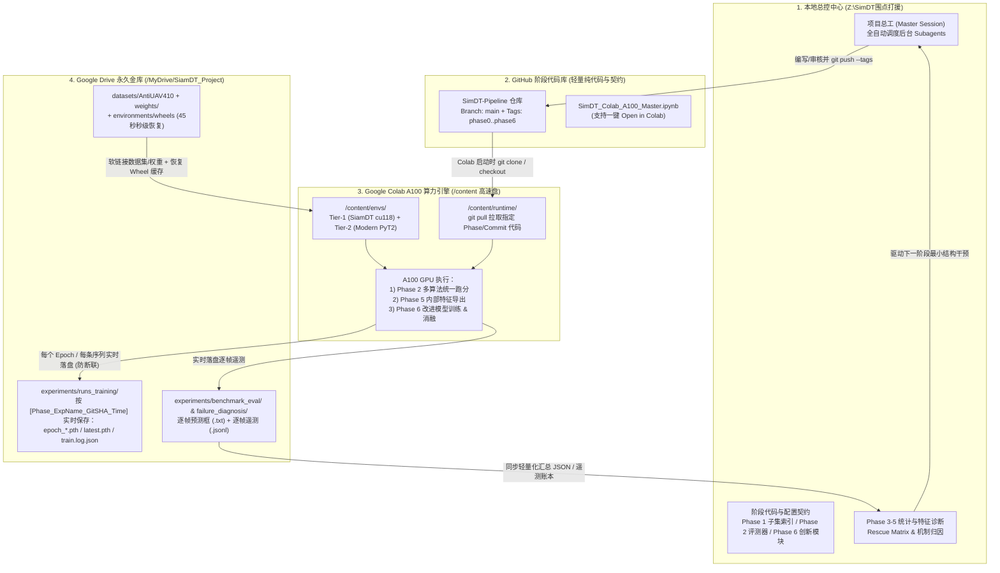

# SimDT 围点打援｜“本地总控 + GitHub 阶段代码 + Colab 云端训练/评测 + Google Drive 权重日志金库”四位一体工程架构书

- **制定人**：项目总工（Master Control Session）
- **制定时间**：2026-11-04
- **审阅基座**：已合并远程服务器经理提交的 [COLAB_MULTI_TRACKER_PROMPT_AND_SPEC.md](file:///Z:/SimDT%E5%9B%B4%E7%82%B9%E6%89%93%E6%8F%B4/colab_a100_engineering/COLAB_MULTI_TRACKER_PROMPT_AND_SPEC.md) 与 [colab_init_cells.py](file:///Z:/SimDT%E5%9B%B4%E7%82%B9%E6%89%93%E6%8F%B4/colab_a100_engineering/colab_init_cells.py)，并补齐了其缺失的 **GitHub 阶段代码版本控制与双向同步闭环**。

---

## 一、 对远程服务器经理汇报的总工审查结论（`【事实】` + `【建议】`）

### 1.1 远程服务器经理已完成的高价值工作（予以保留并直接复用，`【事实】`）
1. **攻克了原始 `SiamDT` 在 Colab A100 (`sm_80`) 上的环境兼容难题**：
   - 设计了 `Tier-1 (env_siamdt_cu118)` 独立环境（`Python 3.10.19 + torch==2.0.0+cu118 + torchvision==0.15.1+cu118 + mmcv-full==1.7.2` + `uv` 极速安装器 + `torch._six` 垫片）；
   - 提炼出 **3 项零语义侵入补丁**（`mmdet/__init__.py` 版本上限放宽至 `1.7.2`、`bbox_nms.py` 跨设备张量对齐、`datasets/wrappers.py` 数据集路径环境变量化 `ANTI_UAV410_ROOT`），**100% 保持原始 `SiamDT` 的 245 个参数张量 `strict=True` 无损加载**。
2. **建立了双轨运行环境与离线缓存加速机制**：
   - 将 `Tier-1`（原始及改进版 `SiamDT`）与 `Tier-2`（2025–2026 核心实验池：PyTorch 2.x 原生环境）隔离在 Colab 本地高速盘 `/content/envs/`，同时把 `pip-cache` 与 `uv-cache` 持久化在 Google Drive，使 Colab 重连后的环境恢复缩短至 **45~60 秒**。
3. **验证了官方权重 SHA-256 哈希与零覆盖资产扫描**：
   - 锁定了 `siamdt_swin_tiny_sgd.pth`（`499,427,901` 字节，SHA-256: `b4c7e0e0...`）与 `cascade_mask_rcnn_swin_tiny.pth.tar`（`121,266,712` 字节，SHA-256: `f8f9a52b...`）。

### 1.2 远程服务器经理方案的缺口与总工补齐（`【事实】`）
- **原方案缺口**：[colab_init_cells.py](file:///Z:/SimDT%E5%9B%B4%E7%82%B9%E6%89%93%E6%8F%B4/colab_a100_engineering/colab_init_cells.py) 的 `CELL 2` 仅从上游官方仓库 `HwangBo94/Anti-UAV410` 拉取死代码，**缺少我们自己的“GitHub 阶段代码仓库”作为本地总控与 Colab 之间的桥梁**。如果只在 Colab 单元格里散装写代码，Phase 1–6 的阶段脚本和后续改进版 `SiamDT` 模块将无法做严谨的版本追溯。
- **总工升级裁定**：正式确立 **“四端职责分离、代码走 GitHub、重资产与实验账本走 Google Drive、计算走 Colab A100、调度走本地总控”** 的标准工程体系。

---

## 二、 四位一体协同体系架构（Architecture Overview）

---

## 三、 三大核心机制设计（确保“不丢代码、不丢权重、不断联白跑”）

### 3.1 代码走 GitHub：按 Phase 标签（Git Tag）锁死每次实验的代码版本
1. **什么进 GitHub（由 `.gitignore` 严格把关）**：
   - `phase0_method_census/`：核心实验池与参考池账本；
   - `phase1_diagnostic_subset/`：`build_diagnostic_subset.py` 及冻结的 `discovery_set.json`、`holdout_verification.json`；
   - `phase2_unified_eval/`：统一逐帧遥测评测器（Unified Telemetry Evaluator）与各算法 Wrapper；
   - `phase3_to_5_diagnosis/`：Canonical Challenge Windows 提取、Rescue Matrix 计算与内部特征探针脚本；
   - `phase6_siamdt_innovations/`：针对原始 `SiamDT`（`siamdt_rcnn.py` 等）的可插拔改进模块与对应的 `configs/siamdt_ours_*.py`；
   - `colab_a100_engineering/`：Colab 一键主控 Notebook `SimDT_Colab_A100_Master.ipynb`。
2. **阶段里程碑标签（Git Tagging 规范）**：
   - 每通过一个 Gate，本地总控自动打上 Git Tag：
     - `v0.1-phase0-pool-locked`
     - `v1.0-phase1-subset-frozen`
     - `v2.0-phase2-unified-eval`
     - `v6.x-exp-<module_name>`（每次在 Colab 启动训练前，必须对应一个唯一的 Git Commit SHA）。

### 3.2 权重与日志走 Google Drive：实时落盘 + 断点续训（Auto-Resume）
在 Colab 上跑 `SiamDT` 训练（如 12/20 Epochs）或多算法长时评测时，最怕 Colab 网页断开导致几个小时白跑。为此我们在 Google Drive `/content/drive/MyDrive/SiamDT_Project/` 下执行以下四条硬性工程保障：
1. **实验目录绑定 Git Commit SHA**：
   - 每一个训练或评测任务的 `--work_dir` 直接指向 Google Drive：
     `/content/drive/MyDrive/SiamDT_Project/experiments/runs_training/{phase}_{exp_name}_{git_short_sha}/`
   - 目录内自动写入 `run_metadata.json`（记录当前 Git Commit SHA、`git diff`、配置文件快照、随机种子 `seed=42`、GPU 型号及启动时间）。
2. **逐 Epoch 权重持久化与自动断点续训（Auto-Resume）**：
   - MMDetection 的 `CheckpointHook(interval=1)` 直接将 `epoch_1.pth ... epoch_N.pth` 和 `latest.pth` 写入上述 Google Drive 目录；
   - Colab 启动脚本内置自动检测逻辑：若指定实验目录下已存在 `latest.pth`，自动将 `--load_from` 切换为 `--resume_from "{TRAIN_WORK_DIR}/latest.pth"`，实现**断线重连后从上一轮 Epoch 零损失继续训练**！
3. **训练日志双通道实时刷盘（Flush-on-Write）**：
   - 同时保存人类可读的 `train.log` 与机器可解析的 `train.log.json`（记录每个 iteration 的 `loss_rpn_cls`、`loss_rpn_bbox`、`loss_cls`、`loss_bbox`、学习率 `lr` 与显存占用），每 50 个 iteration 强制 `fsync` 刷入 Google Drive。
4. **评测逐序列断点跳过（Sequence-Level Checkpointing）**：
   - 在跑 `Discovery Set` 或 `val90` 多算法评测时，每跑完 1 条视频序列立即将预测框 `.txt` 与逐帧遥测 `.jsonl` 写入 Google Drive 的 `experiments/benchmark_eval/`；若中途断开，重跑时自动跳过已存在且帧数校验完整的序列。

---

## 四、 三级算力精确分工（主力 Colab A100 + 辅助 Colab L4 + 小部分本机总控）

根据您的明确要求（**大部分时间用 Colab A100、小部分时间用 Colab L4、小部分时间用本机**），整个工程的算力分配与兼容性严格锁定如下：

| 算力层级 | 占比规划 | 硬件规格与 CUDA 架构 | 承担的核心阶段任务 | 兼容性与自动适配设计 (`【事实】`) |
| :--- | :--- | :--- | :--- | :--- |
| **1. 主力云端算力：Colab A100** | **70%–80%** *(绝大部分时间)* | `NVIDIA A100-SXM4-40GB/80GB` Ampere 架构 (`sm_80`) | - **Phase 2**：原始 `SiamDT` 与 Tier-1 核心实验池多算法全量统一评测； - **Phase 6**：改进版 `SiamDT` 候选模块的完整多 Epoch 训练、受控消融（Remove / Disable / Replace）与 Holdout 独立验证。 | `torch==2.0.0+cu118` + `mmcv-full==1.7.2` 原生包含 `sm_80` SASS 内核；Notebook 自动识别 `A100` 并开启高吞吐 `workers_per_gpu` 与并行评测。 |
| **2. 辅助云端算力：Colab L4** | **10%–15%** *(小部分时间)* | `NVIDIA L4 (24GB VRAM)` Ada Lovelace 架构 (`sm_89`) | - **Phase 2 前置**：新接入模型或新写模块的 5 帧冒烟测试（Smoke Test）与单序列快速试跑； - **Phase 5**：针对筛出的少量典型失败事件（Canonical Challenge Windows），提取并导出 `SiamDT` 内部特征图与诊断指标。 | `CUDA 11.8` (`cu118`) 原生支持 Ada `sm_89` 架构！与 A100 **100% 共享同一份 Google Drive Wheel 缓存**，切换 L4/A100 时无需重新编译任何包，且脚本自动适配 L4 24GB 显存参数。 |
| **3. 本地轻算力：本机 VS Code** | **10%–15%** *(小部分时间)* | 本地总控环境 (`G:\我的云端硬盘\SimDT围点打援`) | - **总控大脑调度**：全自动派发后台子智能体、把关 Gate 0–6； - **Phase 1 / 3 / 4**：基于 JSON/JSONL 账本运行轻量级数据统计（子集分层抽样、Failure Matrix、Rescue Matrix、风险分布回归）； - **代码研发与同步**：编写阶段代码与改进模块，一键 `git push` 推送至 GitHub。 | 本机不承担重型 GPU 训练或大规模视频帧推理，彻底避免本机长时间满载或 Windows 算子编译折腾。 |

---

## 五、 您与总控会话的极简协作流（零手动命令负担）

既然您已决定**不再手动发命令给子窗口**，接下来的全流程将按如下全自动模式运转：
1. **本机所有研发、脚本编写、子集构建、统计分析与代码提交**：全部由我（项目总工）在后台通过 `invoke_subagent` 自动拉起专项子智能体完成，完成后自动汇总向您汇报。
2. **GitHub 远端绑定**：我已将本地 `Z:\SimDT围点打援` 初始化为 Git 仓库并完成首次阶段提交；您只需提供一个您 GitHub 账号下的空仓库地址（例如 `https://github.com/AKAreader/SimDT-Pipeline.git`），或者授权我配置远端，后续每次阶段代码更新都由我自动 `git commit & push`。
3. **Colab 端执行**：我为您生成唯一的 **`SimDT_Colab_A100_Master.ipynb`**。您在 Colab 打开该 Notebook 后，只需要点“全部运行（Run All）”或运行指定阶段的单元格——它会自动挂载您的 Google Drive、从 GitHub 拉取我刚推送的最新阶段代码、把所有训练日志和模型权重稳稳当当地存进您的 Google Drive！
