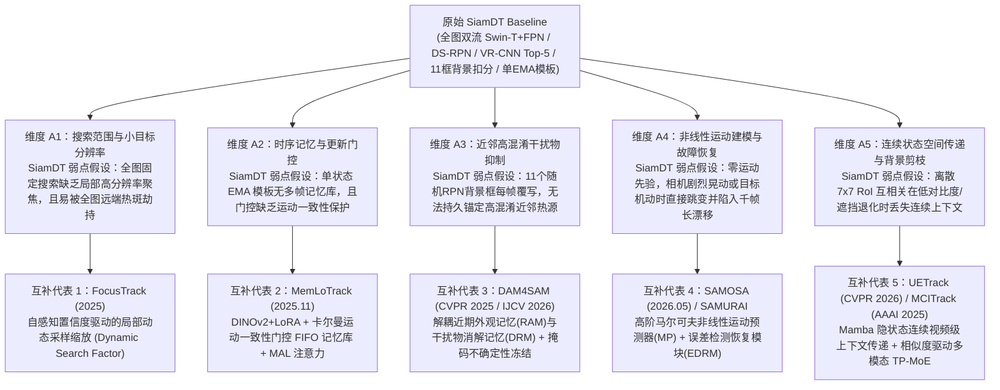

# Phase 0 阶段报告｜2025–2026 红外与反无人机单目标跟踪方法普查及实验池设计

> [!IMPORTANT]
> **当前阶段门禁状态（Gate 0）**：**已完成普查与实验池设计，立即停止，等待用户与项目总工审查确认。**  
> 本阶段严格遵守停止条件：**未启动任何大规模 GPU 实验、未运行师兄方法（SiamISDT）、未修改原始 SiamDT 代码、未提前设计新模块或提出模块拼接方案。**

---

## 一、阶段报告核心要素总览（按既有 EVIDENCE 与记忆规范记录）

| 记录项 | 详细内容 |
|---|---|
| **本阶段目标** | 围绕**原始 SiamDT baseline**（[`SiamDTRCNN`](file:///D:/CodexProjects/SiamDT_Project/code/Anti-UAV410/trackers/SiamDT/trackers/siamdt_rcnn.py#L21-L518)），调研并核验 2025–2026 年相关性高、具互补机制的单目标跟踪方法，按“代码/权重可获性、复现可靠性、协议对齐能力、结构互补价值”划分为 **Core Experimental Pool（核心实验池）** 与 **Reference Pool（参考方法池）**，给出第一批推荐核心实验方法组合。 |
| **实际执行内容** | 1. 只读核查本地原始 SiamDT 源码与配置（[`siamdt_rcnn.py`](file:///D:/CodexProjects/SiamDT_Project/code/Anti-UAV410/trackers/SiamDT/trackers/siamdt_rcnn.py)、[`siamdt_swin_tiny_sgd.py`](file:///D:/CodexProjects/SiamDT_Project/code/Anti-UAV410/trackers/SiamDT/configs/siamdt_swin_tiny_sgd.py)）及既有项目状态入口（[`CURRENT_RESEARCH.json`](file:///E:/PHD/YB/yb/CURRENT_RESEARCH.json)、[`BASELINE_FULLVAL90_STATS.json`](file:///E:/PHD/YB/yb/research_20261103/failure_diagnosis/BASELINE_FULLVAL90_STATS.json)、[`reading_index.json`](file:///E:/PHD/YB/yb/literature_20261026/reading_index.json)）； 2. 检索 2025–2026 年 CVPR / ICCV / ECCV / AAAI / ICML / NeurIPS / IEEE TGRS / Sensors 等顶会顶刊的红外、反无人机（Anti-UAV）及通用单目标跟踪（SOT）方法； 3. 使用 `curl.exe` 对 **31 个候选 GitHub 仓库**执行在线 HTTP 状态码、仓库顶层文件树及 `README.md` / `MODEL_ZOO.md` 原文核验，剔除“空壳仓库”与“404 失效链接”，确立真实可运行的 Core Experimental Pool。 |
| **修改/新增文件** | 仅在当前独立工作区 [`z:/SimDT围点打援`](file:///z:/SimDT围点打援) 内新增 Phase 0 档案（对 [`E:/PHD/YB`](file:///E:/PHD/YB) 与 [`D:/Research/research-continuity`](file:///D:/Research/research-continuity) 保持 **零写入**，通过只读指针引用既有基线）： - [`PIPELINE_STATE.json`](file:///z:/SimDT围点打援/PIPELINE_STATE.json) - [`PHASE0_METHOD_POOL_CENSUS_20261104.json`](file:///z:/SimDT围点打援/phase0_method_census/PHASE0_METHOD_POOL_CENSUS_20261104.json) - [`PHASE0_REPORT_20261104.md`](file:///z:/SimDT围点打援/phase0_method_census/PHASE0_REPORT_20261104.md) |
| **实验** | **本阶段未运行任何模型推理或训练实验。** 仅执行了针对 31 个外部开源仓库的 HTTP 连通性、目录树完整性与模型权重链接真实性核验实验。 |
| **指标** | **本阶段不生成新的模型评测指标。** 既有原始 SiamDT 基线在 `val90` 上的权威参考分（`SA = 70.3344%`）仅引用自既有核验档案 [`BASELINE_FULLVAL90_STATS.json`](file:///E:/PHD/YB/yb/research_20261103/failure_diagnosis/BASELINE_FULLVAL90_STATS.json)；外部论文各自报告的指标仅在文献背景中单列说明，**严禁与我方后续统一实验数字直接混合比较**。 |
| **证据路径** | - 工作区状态入口：[`PIPELINE_STATE.json`](file:///z:/SimDT围点打援/PIPELINE_STATE.json) - 方法普查结构化数据库：[`PHASE0_METHOD_POOL_CENSUS_20261104.json`](file:///z:/SimDT围点打援/phase0_method_census/PHASE0_METHOD_POOL_CENSUS_20261104.json) - GitHub HTTP 状态核验日志：[`task-65.log`](file:///C:/Users/Administrator/.gemini/antigravity/brain/611a8caf-a6f3-40d9-8d8a-4173bfcaca85/.system_generated/tasks/task-65.log) - 仓库文件树核验日志 1 & 2：[`task-72.log`](file:///C:/Users/Administrator/.gemini/antigravity/brain/611a8caf-a6f3-40d9-8d8a-4173bfcaca85/.system_generated/tasks/task-72.log)、[`task-89.log`](file:///C:/Users/Administrator/.gemini/antigravity/brain/611a8caf-a6f3-40d9-8d8a-4173bfcaca85/.system_generated/tasks/task-89.log) - 仓库 README 原文抓取日志：[`steps/79/output.txt`](file:///C:/Users/Administrator/.gemini/antigravity/brain/611a8caf-a6f3-40d9-8d8a-4173bfcaca85/.system_generated/steps/79/output.txt)、[`steps/94/output.txt`](file:///C:/Users/Administrator/.gemini/antigravity/brain/611a8caf-a6f3-40d9-8d8a-4173bfcaca85/.system_generated/steps/94/output.txt)、[`steps/99/output.txt`](file:///C:/Users/Administrator/.gemini/antigravity/brain/611a8caf-a6f3-40d9-8d8a-4173bfcaca85/.system_generated/steps/99/output.txt) |
| **异常与失败** | 1. **论文声称开源但实际 404/空壳（已拦截）**：实测发现 ICCV 2025 `MCATrack`（`zhangjiahao02/MCATrack`）、`SATATrack`（`XiaozhenQiao/SATATrack`）、ICLR 2026 `FARTrack`（`wangguijiepedeval/FARTrack`）返回 **HTTP 404**；IEEE TGRS 2026 `TAPTrack`（`cui344119693/TAPTrack`）、NeurIPS 2025 `LoRATv2`（`LitingLin/LoRATv2`）、CVPR 2026 `TGTrack`（`wtg1/TGTrack`）、AAAI 2025 `TemTrack`（`GXNU-ZhongLab/TemTrack`）虽返回 HTTP 200，但仓库内**仅有 `README.md` / `poster.svg`，无实际模型源码**；CVPR 2026 `DTPTrack`（`NorahGreen/DTPTrack`）虽有完整源码但**尚未上传预训练权重**。上述方法已全部严格拦截在 Core Experimental Pool 之外，归入 Reference Pool。 2. **GitHub REST API 匿名限流**：未认证 REST API 在连续查询约 35 次后触发每小时 60 次限额（HTTP 403 Rate Limit），但 `raw.githubusercontent.com` 与直接 HTTPS 访问不受影响，所有候选仓库的顶层文件树与 README 均已在触发限流前完整取回落盘。 |
| **Gate 是否通过** | **Gate 0 待审查（Awaiting Confirmation）**：Phase 0 交付物已齐备，等待你和项目总工确认最终的 **Core Experimental Pool** 名单。 |
| **未解决问题** | 1. 第一批 Core Experimental Pool 的规模定为 **4 个还是 5 个方法**（见第六节决策项）； 2. 对跨模态/通用预训练模型（如 `UETrack` / `MCITrack`），在 Phase 2 首轮诊断子集上是先采用**官方公开权重直接推理（Zero-Shot Cross-Domain）**以检验纯粹机制的 Rescue 能力，还是要求先在 Anti-UAV410 训练集上统一微调（In-Domain Retrained）。 |
| **下一步建议** | 请审阅本报告第七节推荐的 **第一批 Core Experimental Pool（5 个正交互补方法）**。确认后进入 **Phase 1｜Anti-UAV 代表性诊断子集（Discovery Set + Holdout Verification Set）构建**。 |

---

## 二、诊断主体定位：原始 SiamDT Baseline 的结构特征与潜在弱点映射

在挑选外部对比算法之前，必须先基于源码明确**原始 SiamDT Baseline** 的真实结构机制，从而让外部算法池形成有针对性的**“围点打援”互补诊断阵列**，而非盲目按论文刷榜分数堆砌对比方法。

### 2.1 【事实】原始 SiamDT Baseline 代码级结构清单
依据本地官方源码 [`siamdt_rcnn.py`](file:///D:/CodexProjects/SiamDT_Project/code/Anti-UAV410/trackers/SiamDT/trackers/siamdt_rcnn.py#L21-L518) 与配置 [`siamdt_swin_tiny_sgd.py`](file:///D:/CodexProjects/SiamDT_Project/code/Anti-UAV410/trackers/SiamDT/configs/siamdt_swin_tiny_sgd.py#L6-L120)：
1. **全图两阶段检测范式（Full-Image Two-Stage Detector）**：基于 MMDetection 2.11 的 `TwoStageDetector`，**不裁剪局部搜索区域（No Local Search Crop）**，每帧将整张红外图像（`640×512`，缩放至长边 `1333`）送入 `SwinTransformer`（Swin-Tiny）+ 5 层 `FPN`（感受野步长 `strides = [4, 8, 16, 32, 64]`）。
2. **双语义候选提议（DS-RPN，[`_process_gallary`](file:///D:/CodexProjects/SiamDT_Project/code/Anti-UAV410/trackers/SiamDT/trackers/siamdt_rcnn.py#L436-L445)）**：用 `7×7` 的模板 RoI 特征 `_bbox_feats_z` 通过 `RPN_Similarity_Learning` 对 5 层 FPN 特征做调制（`x = x + x_corr`），由 `RPNHead` 在全图生成最多 1000 个候选框（Proposals）。
3. **双分支 R-CNN 与 Top-5 硬截断（VR-CNN，[`simple_test_bboxes`](file:///D:/CodexProjects/SiamDT_Project/code/Anti-UAV410/trackers/SiamDT/trackers/siamdt_rcnn.py#L187-L263) & [`_process_gallary`](file:///D:/CodexProjects/SiamDT_Project/code/Anti-UAV410/trackers/SiamDT/trackers/siamdt_rcnn.py#L448-L460)）**：对候选框提取 `7×7` `RoIAlign` 特征，一路经 `RCNN_Similarity_Learning` 输出匹配框 `tra_bboxes`，另一路直接输出检测框 `det_bboxes`；两者拼接后按原始分类得分降序排列，**仅保留前 5 个候选框（`Top_NUM = 5`）**进入后续处理。
4. **11 框背景最大相似度线性扣分与邻域互增强（[`_process_gallary`](file:///D:/CodexProjects/SiamDT_Project/code/Anti-UAV410/trackers/SiamDT/trackers/siamdt_rcnn.py#L462-L498)）**：在初始化或更新帧中，从 RPN 候选框中顺序选取 11 个与目标框 `IoU <= 0` 的区域作为背景特征 `_bbox_feats_bg`；推理时对 Top-5 候选框分别计算与这 11 个背景框的匹配得分，减去最大背景得分（`score -= mm_max_scores`），再对 Top-5 内互 `IoU > 0.8` 的框做加分。
5. **单状态 EMA 模板更新与背景整批覆写（[`_update_query`](file:///D:/CodexProjects/SiamDT_Project/code/Anti-UAV410/trackers/SiamDT/trackers/siamdt_rcnn.py#L393-L427) & [`_process_gallary`](file:///D:/CodexProjects/SiamDT_Project/code/Anti-UAV410/trackers/SiamDT/trackers/siamdt_rcnn.py#L500-L508)）**：当 `tra_bboxes[0, -1] + det_bboxes[0, -1] > 1.9` 且 `IoU(det_bboxes[0], tra_bboxes[0]) > 0.8` 时，以固定学习率 `_learning_rate = 0.01` 对单个模板 `_bbox_feats_z` 做指数移动平均（EMA）更新，并**将 `_bbox_feats_bg` 整批替换为当前帧新抽的 11 个 RPN 框**。
6. **无运动模型、无缺失帧表达**：代码中**完全不包含**任何运动位置预测（如卡尔曼滤波、速度外推、光流相机运动补偿 GMC），且每帧恒定输出四维框，无法输出“目标消失（Absent）”状态。

### 2.2 【实验结论】既有 `val90` 基线统计揭示的主要失分结构
依据既有只读统计档案 [`BASELINE_FULLVAL90_STATS.json`](file:///E:/PHD/YB/yb/research_20261103/failure_diagnosis/BASELINE_FULLVAL90_STATS.json#L13-L101)（完整 `val90` 共 94,711 帧，宏平均 `SA = 70.3344%`）：
- **极小目标失分严重**：在目标面积平方根 `< 16 px` 的 24,775 帧中，原始 SiamDT 的零重叠比例（`IoU = 0`）高达 **42.39%**，平均 IoU 仅为 `0.4148`；而在 `>= 32 px` 的帧中零重叠比例仅为 `0.20%`。
- **长程不可逆漂移占主导**：在全部 649 个零重叠事件（共 11,716 帧，造成 `8.78 pp` 宏平均 SA 损失）中，**仅 19 个长度 `101+` 帧的超长漂移事件（共 7,101 帧）就占了全部零重叠帧数的 60.61%（`5.28 pp` SA 损失）**；一旦跟丢，极难自发恢复。
- **目标消失帧恒定得 0 分**：2,088 个目标消失帧（Absent）因模型恒输出四维框而全部得 0 分（理想上界损失 `1.76 pp`）。

### 2.3 【Codex 推测】需要通过跨算法对比验证的 5 大结构弱点假设
为了在 Phase 2–5 中查明“别人为什么成功而 SiamDT 为什么失败”，我们需要外部跟踪器在以下 **5 个正交机制维度**上与 SiamDT 形成对照：

---

## 三、2025–2026 候选方法普查总表（实测核验结果）

> [!NOTE]
> **核验标准说明（【事实】）**：以下所有仓库均于 `2026-11-04` 通过 `curl.exe` 实测访问 GitHub 仓库主页、顶层文件列表及 `README.md` 原文。凡出现“HTTP 404”、“仅有 README 无代码”或“有代码但未发布预训练权重”的方法，一律禁止进入第一批 **Core Experimental Pool**。

### 3.1 Core Experimental Pool 候选池（代码完整 + 权重可下载 + 可统一评测）

| 编号 | 候选方法 | 年份与发表出处 | 技术路线（Paradigm） | 与 SiamDT 的主要区别 | 开源代码状态（【事实】） | 模型权重状态（【事实】） | 能否公平复现与对齐协议 | 推荐层级 |
|---|---|---|---|---|---|---|---|---|
| **CORE-01** | **FocusTrack** | 2025 `arXiv:2504.13604` | 单流 ViT（DropMAE）+ **自感知局部动态采样缩放（Self-Adaptive Local Sampling）** | 摒弃全图固定 RPN 搜索；采用局部搜索裁剪，根据预测状态动态放大/缩小搜索区域因子（`Search Factor`）以兼顾极小目标分辨率与大机动重捕获 | **是（HTTP 200）** [`vero1925/FocusTrack`](https://github.com/vero1925/FocusTrack) 含完整 `lib/`, `tracking/`, `experiments/` | **有（已核实）** Google Drive & 百度网盘（提取码 `1106`），含 FocusTrack 权重及同库重训的 `OSTrack`、`ROMTrack`、`ZoomTrack`、`DropTrack` 权重 | **能（同域 In-Domain）** 原生采用 Anti-UAV410 训练集训练，评测划分完全一致 | **第一批推荐（P0）** 对应维度 A1 |
| **CORE-02** | **MemLoTrack** | 2025.11 *MDPI Sensors* `10.3390/s25237359` | 冻结 DINOv2 + LoRA（参数高效微调）+ **门控 FIFO 记忆库 + 卡尔曼运动一致性校验 + 记忆注意力层（MAL）** | 冻结基础模型 + LoRA；维护多帧 FIFO 记忆库，同时用**分类置信度与卡尔曼滤波运动一致性**双重门控防止污染，而非 SiamDT 的无运动约束单状态 EMA | **是（HTTP 200）** [`SeoulTech-HCIRLab/MemLoTrack`](https://github.com/SeoulTech-HCIRLab/MemLoTrack) 内置 `Anti-UAV410/`, `trackit/`, `config/` | **有（已核实）** Google Drive 提供两套 Anti-UAV410 权重：`antiuav410_retrained_weight.bin` 与 `antiuav410_scratch_weight.bin` | **能（同域 In-Domain）** 同时提供 `scratch`（纯 Anti-UAV410 训练）与 `retrained`（通用预训练+微调）双权重对照 | **第一批推荐（P0）** 对应维度 A2 |
| **CORE-03** | **DAM4SAM** *(SAM 2.1++)* | 2025–2026 CVPR 2025 / IJCV 2026 `arXiv:2411.17576` | SAM 2.1 基础模型 + **干扰物感知双记忆库（RAM 近期外观记忆 + DRM 干扰物消解记忆）+ 掩码内省不确定性冻结** | 将“目标外观适应（RAM）”与“近邻干扰物抑制锚点（DRM）”彻底解耦，并在预测掩码出现多连通域/面积突变时冻结 DRM 更新，远比 SiamDT 11 个随机 RPN 背景框精准 | **是（HTTP 200）** [`jovanavidenovic/DAM4SAM`](https://github.com/jovanavidenovic/DAM4SAM) 含 `dam4sam_tracker.py` 及框数据集评测入口 `run_on_box_dataset.py` | **有（已核实）** 免训练（Training-free）记忆管理机制，直接使用 Meta 官方公开的 SAM 2.1 权重 | **能（零样本 Zero-Shot）** 支持首帧 GT 边界框初始化并逐帧输出预测框与置信度（分组标注为零样本基础模型） | **第一批推荐（P0）** 对应维度 A3 |
| **CORE-04** | **SAMOSA** *(含基线 SAMURAI)* | 2026.05 `arXiv:2605.22538` *(SAMURAI: 2025)* | SAM 2.1 + **高阶马尔可夫非线性运动预测器（MP）+ 误差检测恢复模块（EDRM）+ 目标感知记忆库（TAMB）** | 针对无人机复杂非线性运动，引入纯轨迹训练的非线性运动预测器（MP）与显式故障检测恢复状态机（EDRM），填补 SiamDT 完全缺失的运动先验与漂移自救机制 | **是（HTTP 200）** [`DurYi/SAMOSA`](https://github.com/DurYi/SAMOSA) 及 [`yangchris11/samurai`](https://github.com/yangchris11/samurai) | **有（已核实）** 运动预测器权重 `sam2/checkpoints/mp.pth` 已直接内置于仓库中，配合官方 SAM 2.1 权重即可运行 | **能（视觉零样本 + 轨迹运动先验）** 论文已专门在 Anti-UAV 复杂运动场景验证，支持标准首帧框初始化 | **第一批推荐（P1）** 对应维度 A4 |
| **CORE-05** | **UETrack / MCITrack** | 2026 / 2025 CVPR 2026 (`2603.01412`) AAAI 2025 (`2412.11023`) | **MCITrack**：基于 **Mamba 隐藏状态（Hidden States）** 的层间视频级连续上下文传递； **UETrack**：5 模态统一（含红外）Token-Pooling 混合专家（TP-MoE） | 摒弃离散 `7×7` RoI 互相关；MCITrack 用 Mamba 隐状态连续传递长程视频上下文，UETrack 用相似度驱动的轻量专家路由动态适应红外热退化特征 | **是（HTTP 200）** [`kangben258/UETrack`](https://github.com/kangben258/UETrack) [`kangben258/MCITrack`](https://github.com/kangben258/MCITrack) | **有（已核实）** UETrack 全系权重托管于 HuggingFace（`kangben258/UETrack`）；MCITrack 权重托管于 Google Drive | **能（跨域预训练 / 可微调）** 标准 PyTracking/OSTrack 评测接口，易对齐 Anti-UAV 数据格式并导出内部响应图 | **第一批推荐（P1）** 对应维度 A5 |
| **RES-01** | **AsymTrack** | 2025 AAAI 2025 `arXiv:2503.00516` | **非对称双流孪生网络（Asymmetric Two-Stream）** + 高效模板调制（ETM）+ 目标感知增强（OPE） | 与 SiamDT 同属“双流特征提取+模板调制”家族，但通过非对称深度与 OPE 模块大幅改善双流特征交互效率与判别力 | **是（HTTP 200）** [`jiawen-zhu/AsymTrack`](https://github.com/jiawen-zhu/AsymTrack) | **有（已核实）** Google Drive & 百度网盘（提取码 `asym`） | **能** 标准 PyTracking 评测接口 | **第二梯队备选** （双流同构对照） |
| **RES-02** | **UTPTrack** | 2026 CVPR 2026 `arXiv:2602.23734` | **统一三组件冗余 Token 剪枝（Unified Token Pruning）**：联合剪除搜索区、动态模板与静态模板中 >65% 冗余背景 Token | 在主干注意力交互阶段即主动剪除大部分背景杂波 Token，对比 SiamDT 在末端仅对 Top-5 做背景扣分 | **是（HTTP 200）** [`EIT-NLP/UTPTrack`](https://github.com/EIT-NLP/UTPTrack) | **有（已核实）** HuggingFace（`HarrisonWu/UTPTrack`） | **能** 提供 `UTPTrack-O`（OSTrack 基座）与 `UTPTrack-S`（SUTrack 基座） | **第二梯队备选** （早期背景剪枝对照） |
| **RES-03** | **ORTrack / SGLATrack** | 2025 CVPR 2025 `2504.09228` / `2503.06625` | 面向无人机实时跟踪的**遮挡鲁棒随机掩码蒸馏 ViT（ORTrack）**与**相似度引导层自适应 ViT（SGLATrack）** | 针对无人机高频局部遮挡进行显式掩码恢复训练与层自适应动态推理 | **是（HTTP 200）** [`wuyou3474/ORTrack`](https://github.com/wuyou3474/ORTrack) [`GXNU-ZhongLab/SGLATrack`](https://github.com/GXNU-ZhongLab/SGLATrack) | **有（已核实）** Google Drive & 百度网盘（提取码 `cvpr`） | **能** 标准 OSTrack/PyTracking 评测接口 | **第二梯队备选** （UAV 遮挡鲁棒对照） |
| **RES-04** | **MPT** | 2025 ICML 2025 `arXiv:2505.16321` | **即插即用长程运动轨迹提示学习（Motion Prompt Learning）** + 视觉-运动自适应加权解码器 | 将长程历史坐标框序列经三类位置编码映射为视觉空间 Prompt，在目标热辐射微弱时动态提升运动权重 | **是（HTTP 200）** [`zj5559/Motion-Prompt-Tracking`](https://github.com/zj5559/Motion-Prompt-Tracking) | **有（已核实）** 百度网盘（提取码 `8j2g`）提供集成于 OSTrack/SeqTrack/ARTrack 的权重 | **能** 标准 OSTrack 评测接口 | **第二梯队备选** （纯轨迹 Prompt 对照） |
| **RES-05** | **SUTrack / SPMTrack / MambaLCT / SEATrack / DPTracker** | 2025–2026 AAAI'25 / CVPR'25 / CVPR'26 Oral / ICRA'26 | 统一单流多模态（SUTrack）、时空 MoE 微调（SPMTrack）、长程上下文 Mamba（MambaLCT）、跨模态自适应对齐（SEATrack）、夜间 UAV 双提示（DPTracker） | 代表不同模态对齐与参数高效扩展方向 | **全部已实测 HTTP 200 且含完整代码** | **全部已核实有公开权重**（HuggingFace / Google Drive / 百度网盘） | **能** | **扩展储备池** （后续跨数据集扩展备用） |

---

### 3.2 Reference Pool 参考方法池（方法重要、思路值得研究，但暂无法公平复现或缺代码/权重）

> [!WARNING]
> **严格隔离原则**：Reference Pool 中的方法**不进入 Phase 2 统一运行**，仅在 Phase 5–6 提炼功能机制时作为理论与设计参考。**严禁将这些论文中报告的指标数字与我方统一实验测得的数字直接混合制表或直接比较。**

| 编号 | 方法名称 | 年份与发表出处 | 核心技术路线与机制亮点 | 开源与权重实测状态（【事实】） | 归入 Reference Pool 的具体原因与参考价值 |
|---|---|---|---|---|---|
| **REF-01** | **TAPTrack** | 2026.04 *IEEE TGRS* `10.1109/TGRS.2026.3682081` | 扩大局部搜索因子（Search Factor）+ **历史结果时序提示解码器（TPD）**抑制大搜索区背景噪声 + **双跟踪头结合峰旁瓣比（PSR, Peak-to-Sidelobe Ratio）的状态判别机制** | 仓库 [`cui344119693/TAPTrack`](https://github.com/cui344119693/TAPTrack) 为 HTTP 200，但**仅含 `README.md` 与 `LICENSE`（源码标注 Coming Soon），无模型权重**；仅公开了百度网盘（提取码 `ghxs`）的 Anti-UAV410 `.txt` 原始预测框 | **无源码与权重**，无法在 `val90` 诊断集上运行，也无法输出逐帧置信度或内部特征。其 **“双头一致性 + 响应图峰旁瓣比（PSR）联合判别目标状态”** 对改进 SiamDT 的 `up_flag` 更新门控极具机制参考价值；其公开的 `.txt` 仅可作为外部静态框参考。 |
| **REF-02** | **MCATrack** | 2025 ICCV 2025 | **仿生大细胞通路（Magnocellular-inspired）多帧运动响应增强模块**（利用相邻帧运动响应抑制静态背景热杂波、提升极小无人机信噪比）+ 动态交叉引导长程模块 | 论文声明的 GitHub 链接 `https://github.com/zhangjiahao02/MCATrack` **经实测返回 HTTP 404**，无公开代码与权重 | **无代码与权重**。其 **“在特征前端利用多帧时序运动响应放大微弱极小目标信噪比”** 的思路，直接针对 SiamDT 在 `<16 px` 极小目标上单帧静态外观信噪比不足的弱点。 |
| **REF-03** | **DTPTrack** | 2026.06 CVPR 2026 `arXiv:2604.02654` | **抗漂移时序先验（Drift-Resilient Temporal Priors）**：在单流跟踪器中构建对累积定位误差免疫的时序先验机制 | 仓库 [`NorahGreen/DTPTrack`](https://github.com/NorahGreen/DTPTrack) 为 HTTP 200 且**已开源完整 `trackit` 源码**，但截至 `2026-11-04` **尚未发布预训练权重文件（Releases 为 0）** | 因暂缺官方预训练权重，无法直接执行零偏差复现推理。将其列为 **Reference Pool 头号观察项**（一旦作者上传权重或后续批准从头训练，可随时转入实验池），重点参考其抗漂移时序先验构造代码。 |
| **REF-04** | **Dist-Tracker** | 2025.06 CVPRW 2025 *(第 4 届 Anti-UAV Track 3 冠军)* | YOLOv12 + **尺度/形状/框质量感知小目标检测（SSQ）** + **L2 中心距离与 IoU 混合度量 SORT** + **基于稀疏光流的全局运动补偿（GMC）** | 仓库 [`earth-insights/Dist-Tracker`](https://github.com/earth-insights/Dist-Tracker) 为 HTTP 200 且含 `ultralytics/` 源码，但面向多目标 Track 3（MOTA 协议），README 未直接提供 Anti-UAV410 单目标权重 | 任务协议不同（属无首帧特定模板匹配的全图类别检测关联），但其针对 `640×512` 红外视频设计的 **“稀疏光流相机全局运动补偿（GMC）+ 极小目标 L2-IoU 混合关联度量”** 代码可直接作为解决 SiamDT 相机晃动跳变与极小框 IoU 退化的机制参考。 |
| **REF-05** | **CMRTrack** | 2026.07 `arXiv:2607.23209v1` | **反事实运动可靠性学习（Counterfactual Motion Reliability Learning）**：通过反事实干预动态评估运动先验可靠性 | 未开源代码与权重；且论文存在在测试集上做参数分析的表述 | **无代码与权重、协议不完全对齐**。仅参考其“当运动预测与视觉外观冲突时，如何通过反事实可靠性评分动态分配权重”的机制思想。 |
| **REF-06** | **DLST** | 2025.06 CVPRW 2025 Anti-UAV | **长时无人机跟踪的双模板协同演化学习（Dual-Template Co-Evolution Learning）** | 未开源代码与权重 | **无代码与权重**。参考其静态锚定模板与动态演化模板的协同更新机制。 |
| **REF-07** | **FSTC-DiMP** | 2025.08 *MDPI Remote Sensing* `10.3390/rs17162902` | 在线判别式滤波（DiMP）+ 频域-空域-时域上下文 + 大核选择性感受野（LSK） | 未开源代码与权重（注：基础 `DiMP50` / `Super_DiMP` / `KeepTrack` 代码与 Anti-UAV410 重训结果已存在于本地 [`Anti_yb`](file:///E:/PHD/YB/Anti_yb/utils/trackers.py#L78-L82)） | **无代码与权重**，且论文正文与消融表存在文字出入。仅作频空时上下文机制参考。 |
| **REF-08** | **SiamDiff / Enhanced-SiamDT / SAM-STIR / UAUTrack / SATATrack / LoRATv2 / TGTrack** | 2025–2026 *Remote Sensing* / *Electronics* / *IEEE TGRS* / NeurIPS'25 / CVPR'26 | 跨帧差分（SiamDiff）、SiamDT 注意力级联（Enhanced-SiamDT）、SAM 红外适配（SAM-STIR）、多模态文本提示（UAUTrack）、因果 KV 缓存 LoRA（LoRATv2）、时序生成解码（TGTrack） | `SATATrack` 为 HTTP 404；`LoRATv2` 与 `TGTrack` 仓库仅有 README/poster 无代码；其余均未开源 | **均无可用源码与权重**。特别地，`Enhanced-SiamDT`（2026.09）在 SiamDT 上堆叠 ECA+LSK+WDAM 注意力级联，其模板/背景改动仅带来 `+0.12 SA`，作为本项目严禁 **Module Shopping（模块拼凑）** 的典型反面教材记录在案。 |

---

## 四、为什么推荐这 5 个方法进入第一批 Core Experimental Pool？（互补性与诊断价值论证）

### 4.1 选池核心逻辑：不唯指标论，构建“正交故障救援矩阵（Orthogonal Rescue Matrix）”
在 Phase 3 中，我们的核心任务是寻找 **Type B（SiamDT 失败，但其他方法成功 Rescue）** 与 **Type C（SiamDT 特有失败）** 事件。如果实验池里的算法全是同一种技术路线（例如全是无记忆的单流局部 ViT），它们会在同一批快速运动或遮挡序列上同生共死，无法提供互补信息。

因此，我们推荐的 **第一批 Core Experimental Pool（5 个方法）** 严格按 **5 条正交机制轴** 选出：

1. **[`FocusTrack`](https://github.com/vero1925/FocusTrack)（2025，同域 Anti-UAV410 训练）—— 诊断“全图搜索 vs 自适应局部缩放”**
   - **【事实】**：SiamDT 每帧在全图范围提议 1000 个候选框并截断 Top-5；FocusTrack 采用局部搜索窗口，并由预测置信度动态调节搜索窗口大小（Search Factor），同时其官方网盘还打包了同在 Anti-UAV410 训练集上重训的 `ZoomTrack`、`DropTrack`、`ROMTrack`、`OSTrack`。
   - **【Codex 推测】**：在“极小目标（`<16 px`）缓慢飞行但远端背景存在强热源（如烟囱、路灯、树冠高光）”的序列中，SiamDT 会因全图搜索被远端热源劫持 Top-5 且小目标在全图下特征过弱而失败；而 FocusTrack 因局部窗口排除了远端背景且提高了目标局部采样分辨率，将大概率成功 Rescue。反之，在目标发生超大跨度突变时，SiamDT 的全图搜索可能优于局部跟踪器。

2. **[`MemLoTrack`](https://github.com/SeoulTech-HCIRLab/MemLoTrack)（2025.11，同域 Anti-UAV410 训练，含 `scratch` 与 `retrained` 双权重）—— 诊断“无运动约束单状态 EMA vs 卡尔曼运动门控多帧 FIFO 记忆”**
   - **【事实】**：SiamDT 仅用单状态 EMA（`lr=0.01`）更新 `_bbox_feats_z`，且更新条件 `tra+det>1.9 & IoU>0.8` 仅检验当前帧双头一致性，不检验空间运动连续性；MemLoTrack 维护多帧 FIFO 记忆库，并在写入前同时执行**分类置信度门控 + 卡尔曼滤波运动一致性校验**，再经 MAL（Motion-Aware Memory Attention Layer）融合。
   - **【Codex 推测】**：当无人机掠过热相似背景物或发生短暂遮挡时，SiamDT 可能在跳变帧满足双头高分而错误更新背景，或因长期不满足 `>1.9` 而模板陈旧退化；MemLoTrack 的卡尔曼运动一致性门控能拦截空间跳变的伪高分帧写入记忆，且其同时提供 `antiuav410_scratch_weight.bin` 与 `antiuav410_retrained_weight.bin`，能帮我们严格拆解“DINOv2 预训练表征增益”与“卡尔曼门控多帧记忆机制增益”。

3. **[`DAM4SAM`](https://github.com/jovanavidenovic/DAM4SAM)（CVPR 2025 / IJCV 2026，SAM 2.1 零样本框初始化）—— 诊断“11 个随机 RPN 背景框扣分 vs 显式干扰物锚定记忆（DRM）与不确定性冻结”**
   - **【事实】**：SiamDT 的 `_bbox_feats_bg` 仅在更新帧从 RPN 中按顺序取前 11 个 `IoU <= 0` 的框，既不区分这些框是不是真正威胁目标的近邻高混淆干扰物，又在每次更新时整批覆写；DAM4SAM 显式维护 **RAM（近期目标外观记忆）** 与 **DRM（专门捕获多峰混淆帧中次优高分干扰物的消解记忆）**，并在输出掩码出现多连通域分裂/面积骤变时判定为“不确定帧”而冻结 DRM 更新。
   - **【Codex 推测】**：在“近邻类目标干扰物（Distractor Proximity）与部分遮挡（Occlusion）”事件中，若 DAM4SAM 在零样本条件下仍能稳定锚定并抑制干扰物、成功 Rescue 同域训练的 SiamDT，将直接证明 SiamDT 的背景抑制失效根源在于“背景样本选择缺乏混淆针对性（Non-hard negative）且更新缺乏不确定性冻结保护”。

4. **[`SAMOSA`](https://github.com/DurYi/SAMOSA)（2026.05，内置 `mp.pth` 非线性运动预测器 + EDRM 故障恢复，配套 `SAMURAI` 线性卡尔曼基线）—— 诊断“零运动模型导致千帧长漂移 vs 非线性运动预测 + 显式误差检测恢复”**
   - **【事实】**：原始 SiamDT 在 `val90` 上 60.61% 的零重叠失分集中于 `101+` 帧的超长不可逆漂移事件（[`BASELINE_FULLVAL90_STATS.json`](file:///E:/PHD/YB/yb/research_20261103/failure_diagnosis/BASELINE_FULLVAL90_STATS.json#L94-L100)）；SAMOSA 专门针对 Anti-UAV 复杂非线性运动设计了**高阶马尔可夫运动预测器（MP）**与**误差检测恢复模块（EDRM）**，且权重 `sam2/checkpoints/mp.pth` 已直接随仓库发布。
   - **【Codex 推测】**：对比 SiamDT（无运动模型）、SAMURAI（线性卡尔曼滤波）与 SAMOSA（非线性马尔可夫 MP + EDRM 恢复）在同一批长漂移事件（Canonical Challenge Windows）上的表现，能够直接定量回答：“SiamDT 的超长漂移究竟多大比例只需线性运动约束即可避免，多大比例需要非线性机动预测与显式故障恢复状态机？”

5. **[`UETrack`](https://github.com/kangben258/UETrack)（CVPR 2026） / [`MCITrack`](https://github.com/kangben258/MCITrack)（AAAI 2025）—— 诊断“离散 7×7 RoI 互相关 vs Mamba 连续隐状态传递 / 多模态动态专家路由”**
   - **【事实】**：SiamDT 将目标特征压缩为离散的 `7×7` RoI 张量做互相关；MCITrack 利用 Mamba 状态空间模型的隐藏状态（Hidden States）在主干层间连续传递视频级上下文，而其 2026 演进版 UETrack 则引入面向红外等 5 模态的 Token-Pooling 混合专家（TP-MoE）。
   - **【Codex 推测】**：在“低对比度（Low Contrast）、热交叉（Thermal Crossover）及目标尺度连续剧烈变化”事件中，MCITrack 的连续隐状态传递与 UETrack 的多模态专家路由能为诊断 SiamDT 的特征交互层（`RPN_Similarity_Learning` / `RCNN_Similarity_Learning`）提供关键的特征级对照。

---

## 五、统一评测与公平性对齐原则（为 Phase 2 预设的硬性协议边界）

为确保后续 Phase 2 运行时不发生评测口径污染，本阶段提前明确以下对齐准则（【建议】）：

1. **严格分组披露训练域属性（In-Domain vs. Zero-Shot/Cross-Domain）**：
   - **同域组（Group I - Anti-UAV410 Trained）**：`Original SiamDT Baseline`、`FocusTrack`（含同库重训的 `ZoomTrack`/`DropTrack`/`OSTrack`）、`MemLoTrack (scratch & retrained)`。
   - **跨域/零样本机制探针组（Group II - Zero-Shot / Foundation / Generic SOT）**：`DAM4SAM`、`SAMOSA`（及 `SAMURAI`）、`UETrack` / `MCITrack`。
   - **作用**：在比较平均指标时严格分栏报告；在 Phase 3 计算 **Rescue Matrix（当 SiamDT 失败时，算法 B 仍成功的条件概率）** 时，若 Group II 零样本模型在未见过 Anti-UAV410 训练集的情况下依然能 Rescue SiamDT 的失败事件，则构成的机制有效性强证据等级最高。
2. **统一输入与初始化协议**：
   - 所有算法在完全相同的序列集合、相同的起始帧与真值框（GT Box）初始化下运行，严禁任何算法在中间帧读取 GT 重置（Zero Reset / One-Pass Evaluation, OPE）。
3. **统一逐帧中间结果落盘规范**：
   - 除预测框 `[x, y, w, h]` 外，统一改造各算法推理入口以同步导出：`frame_id`、`gt_box`、`pred_box`、`iou`、`center_error`、`target_area`、`confidence_score`（对 SiamDT 同时记录 `tra_score`、`det_score`、`bg_max_penalty`、`final_ens_score`、`up_flag`）及推理状态标志。

---

## 六、Gate 0 待确认决策问题（请用户与项目总工指示）

在进入 **Phase 1（Anti-UAV 代表性诊断子集建立）** 之前，请针对以下 3 个具体事项给出确认或调整指令：

1. **第一批 Core Experimental Pool 名单确认**：
   - 是否批准将 **`FocusTrack` + `MemLoTrack` + `DAM4SAM` + `SAMOSA` + `UETrack/MCITrack`** 这 5 个正交代表方法（连同主体 `Original SiamDT Baseline`）作为第一批核心实验池？
   - 是否需要将 `FocusTrack` 官方同库提供的 Anti-UAV410 重训版 `ZoomTrack` / `DropTrack` 或第二梯队的 `AsymTrack`（AAAI 2025 双流同构模型）一并纳入第一批，还是将它们留在第二批按需启用？
2. **数据集第一轮构建源确认（为 Phase 1 准备）**：
   - 本地 [`E:/PHD/YB/Anti_yb/annos`](file:///E:/PHD/YB/Anti_yb/annos) 与服务器已有完整 `Anti-UAV410` 的 `train (200)` / `val (90)` / `test (120)` 标注及属性标签。为严格遵守“不在 test120 上反向挑选数据或调参”的科研纪律，Phase 1 构建 **Anti-UAV Diagnostic Subset（Discovery Set + Holdout Verification Set）** 时，是否同意**优先在 `val90`（或 `train200 + val90`）上依据客观场景属性与官方属性标签分层抽样构建**，而将 `test120` 严格冻结作最终大考？
3. **Reference Pool 中 `TAPTrack`（TGRS 2026）已公开的 `.txt` 预测结果处理方式**：
   - `TAPTrack` 虽无源码和权重（已归入 Reference Pool），但作者公开了 Anti-UAV410 测试集的 `.txt` 原始预测框。是否同意将其仅作为外部静态轨迹档案存档备查，而不混入需要统一环境运行与特征诊断的 Core Experimental Pool？

---

*报告生成时间：2026-11-04｜工作区：[`z:/SimDT围点打援`](file:///z:/SimDT围点打援)｜当前状态：**STOPPED AT GATE 0***
